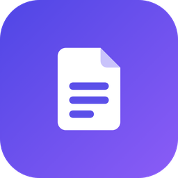

  

<h1 align="center">OffNote</h1>

  <b>Your notes. Your device.</b> 
  A private notes app for Android that works completely offline.

  <a href="https://github.com/ankith5980/offline-notes-releases/releases/latest"><b>⬇️ Download the latest version</b></a>

---

## What is OffNote?

OffNote is a notes app that keeps everything on your phone. There is no account to create, nothing is uploaded to the cloud, and it works without an internet connection. If you also use OffNote on your computer, your notes can sync between your own devices directly over your Wi-Fi, still without any cloud. Write notes, make checklists, sketch drawings, attach photos and files, set reminders, and lock the app or individual folders behind a PIN or your fingerprint.

## What's new in 4.1.2

> ⚠️ **If you sync, update all your devices.** Devices only sync with others on OffNote 4.1.2. If one isn't updated yet, Sync Devices says which device to update; nothing is lost in the meantime.

- **More than passwords in Passwords.** Tap **+ New** and you can now keep your **Aadhaar card**, **PAN card**, **driving licence**, **voter ID**, **bank accounts**, **Wi-Fi networks** and **SSH keys** there too, encrypted with your master password like everything else. See [What you can keep](#what-you-can-keep).
- **Catches typing mistakes.** OffNote checks an Aadhaar number's last digit, the shape of a PAN and an IFSC, and a Wi-Fi password's length, and marks anything that looks wrong. It never stops you: tap **Save** again to keep it as it is.
- **Numbers stay hidden.** Lists and items show only the last four digits (an Aadhaar shows as **XXXX XXXX 1234**) until you tap the eye.
- **Wi-Fi made easy.** Scan the QR code on your router to fill in a network, and show a network as a QR code so a friend's phone can join by pointing its camera at it.
- **SSH keys.** Paste a key or load it from its file (`id_ed25519`, `id_rsa`, a PuTTY `.ppk`): OffNote shows its type and fingerprint, fills in the public key, tells you whether a passphrase protects it, and warns if the public and private keys don't belong together.
- **Bank accounts.** One tap on **Copy Account Details** copies the holder, account number, IFSC, bank and branch to send to someone; your net-banking password and PINs are left out.
- **Driving licence expiry.** A licence that has expired, or runs out within two months, says so in the list.
- Filters for **Bank**, **IDs**, **Wi-Fi** and **SSH Keys** appear once you have such items. Weak or reused **Wi-Fi passwords** now show up in **Password Health** too.

## What's new in 4.1.1

- **A proper clock for reminder and event times.** On Windows (and on a phone held sideways) the clock for picking a time was squeezed: its numbers ran into each other and the **OK** button was cut off. The clock and the calendar now open at full size; on Windows the clock sits under the time, as on the phone. With the phone held sideways the whole clock fits on screen, with **Cancel** and **OK** in sight.
- **Passwords on Windows use the window's width.** The list and the open item had been squeezed into the middle of the window. Now the list sits beside the item at a comfortable width, every filter (including **Favorites** and **2FA**) is in view without scrolling sideways, and the search box, filters and items line up neatly on the left.
- **Quieter touch feedback, everywhere.** Tapping a row, button or field no longer spreads a ripple or flashes a grey block; it shows a soft, brief tint instead. On the phone and on Windows.

## What's new in 4.1.0

> ⚠️ **If you sync, update all your devices.** Devices only sync with others on OffNote 4.1. If one isn't updated yet, Sync Devices says which device to update; nothing is lost in the meantime.

- **Passwords.** A new, separate place for your passwords, cards and secure notes, encrypted with a **master password** only you know (plus your fingerprint or Windows Hello if you like, and a recovery code). Generate strong passwords, see **2FA codes**, check your **password health**, import from your browser or another password manager, and keep them in step on your devices, still encrypted. On Android, OffNote can **fill passwords in other apps and websites**. Open it from the menu (☰) → **Passwords**. See [Passwords](#passwords).
- **Folders inside folders.** Make a folder inside another (**⋯ → New Folder Inside**), or move one with **⋯ → Move to…**. A folder shows its folders above its notes and where it is ("Work / Clients"). On Windows the sidebar is a tree: drag a folder onto another, or onto **Folders** for the top level. A locked folder locks everything inside it, and one PIN opens it all. See [Folders inside folders](#folders-inside-folders).
- **Fixed: locked folders from your other device on the phone.** Notes of a locked folder encrypted on another device stayed "Locked note" on the phone, even after the fingerprint. Now the phone asks for your **folder PIN once** for them; after that your fingerprint opens them too.
- **Fixed:** a locked folder's screen no longer flickers or jumps back to the top while it's open.
- **Fixed (Windows):** after a folder you were viewing locked itself again, **Unlock** in the list didn't ask for the PIN.
- Imports from Evernote, Obsidian and Notion now keep their folders inside folders.

## What's new in 4.0.0

> ⚠️ **Before you update, please read:**
> - **Make a backup first** (Settings → Backup & Restore). This update changes how your notes are stored, and installing an older version afterwards won't bring the old format back.
> - **If you sync, update all your devices.** Devices only sync with others on OffNote 4.0.
> - **Backups made with 4.0 that include an encrypted locked folder can't be restored by older versions**, so restore them with 4.0.

- **Locked folders are now encrypted.** Until now a locked folder hid its notes; now they are encrypted, so even someone who copies the phone's storage can't read them. The first time you enter your folder PIN after updating, OffNote explains what happens, shows you a **new recovery code** (save it: from now on it's the only way back in if you forget the folder PIN, and your old code stops working), then encrypts the notes with a progress bar. **Not now** leaves them as they were and asks again next time. ⚠️ If you forget **both** the folder PIN and the recovery code, nobody can open those notes, not even OffNote. See [Locked Folders](#locked-folders).
- **Reminders and events without a note.** The **+** button in **Reminders** adds a reminder, birthday or event that is just that: a title and a date. They show in Reminders and the Calendar, not in your notes. Birthdays and events you made before that have only a title and a date move there too (nothing is deleted).
- **Birthdays with a name and age.** Type the person's **Name** and **Current age**; OffNote shows "Turns 36 on 24 Jun 2027" so you can check it, and the reminder says "Asha turns 36 today".
- **Writing without symbols.** Bold, headings, lists and links show as they look, without `**`, `#` or `-` around them, even on the line you're writing. Tap **Bold** (or another style) and just type. The **Link** button adds or changes a web link. The formatting bar now works in **tasks, table cells and toggles** too. Prefer the symbols? **Settings → Show Markdown while editing**.
- **On-device AI (optional).** Search your notes **by meaning** ("holiday plans" finds your Goa trip note), **Ask My Notes** a question and get the answer with the passages it came from, and **Summarise** a note from its **⋮** menu. Everything runs on your phone or PC: your notes and questions never leave it. You choose what to download in **Settings → On-device AI** (25 MB for search; 1.0 GB more for written answers, on phones with 6 GB of memory or more). See [On-device AI](#on-device-ai).
- **Export Data.** **Settings → Export Data** saves all your notes (or chosen folders) in one ZIP: Markdown, text, HTML, Word, JSON or PDF, with or without photos and files, optionally locked with a password. See [Export all your notes](#export-all-your-notes).
- **More imports.** **Word (.docx)** documents become notes with their headings, lists, tables and pictures. **CSV** files (and Notion databases) open as a **spreadsheet** you can scroll, with its text searchable. From **Notion**, to-dos become real task lists, and toggles and callouts come in as toggles and callouts.
- **All Notes shows the notes that aren't in a folder.** Notes in folders are in their folders; **Pinned**, **Favorites**, search, tags and the calendar still show everything.
- **+ New works where you are.** In a folder or a tag, every kind of new note (Today's note, imported PDFs, events) goes there. A new **Import** chip imports files right where you are.
- **Asks before deleting.** Deleting notes, tasks with text, table rows, attachments, reminders and pages asks first (and Undo still works).
- **Cleaner look:** flat colours throughout, no glows or blurs.
- **Clearer progress** for imports, restoring a backup and encrypting: one dialog with a progress bar, Cancel, and what happened at the end.
- **Fixed:** a note card's date badge no longer runs off the edge on narrow phones or with large text.

## What's new in 3.14.0

- **Birthdays, meetings and important dates on the calendar.** Add events to the Calendar (**Add event**, **Important**, **Birthday**, or hold a day), or from **+ New → Event**. Choose what it is (birthday, anniversary, meeting, appointment, event, important date, holiday or other), the day, all day or a time, where, and whether it repeats (every day, week, month or **year**). Each event is a note too, so you can write in it: the meeting's agenda, gift ideas. See [Birthdays, events and important dates](#birthdays-events-and-important-dates).
- **Reminders for your dates.** Pick when OffNote reminds you: on the day, a day, two days or a week before (at a time you choose), or 5, 15 or 30 minutes, an hour, a day or a week before a meeting. They ring like any reminder (with Snooze and Done) and appear in **Reminders**. A birthday reminder says "Birthday · tomorrow"; a meeting's says "Meeting · in 15 minutes · 14:30 · Room 4".
- **Ages and anniversaries.** If you know the year, the calendar says "turns 30" or "10th anniversary".
- **Upcoming.** In the Calendar, **Upcoming** lists the next two months of events, soonest first.
- **Every year.** Reminders can now also repeat **every year**.
- **Import from other calendars.** **Settings → Import Notes → Other calendars** brings in events from Google Calendar, Outlook or Apple Calendar (an `.ics` file), with their reminders. Importing the same file again updates them instead of making copies.
- **Events smart folder**, and a small mark on event notes in your list showing when they're next.
- **Sync:** events and their reminders sync between your devices. Both devices need OffNote 3.14.0 to keep syncing with each other, so update both.

## What's new in 3.13.1

- **Locked folders on Windows stay open while you're in them.** Deleting, archiving or closing a note in a locked folder used to lock the folder again straight away, so its other notes vanished from the list until you left the folder and typed the PIN again. Now the folder stays open until you leave it. If it locks while you're inside (for example after you minimise OffNote, or with **Lock OffNote Now**), the list shows an **Unlock** button instead of looking empty.

## What's new in 3.13.0

- **Share to OffNote.** In any app (Chrome, WhatsApp, Gallery, Files…) tap **Share → OffNote**: a small sheet opens where you can give it a title and save it as a **new note** (in a folder of your choice), add it to **today's note**, or add it to **a note** you pick. A shared web link becomes a tidy link with the page's title; pictures and files are attached. **Save** takes you straight back to the app you were in; **Save & open** opens the note. On Windows, right-click files in File Explorer → **Send to → OffNote**.
- **Automatic backups, with a password.** **Settings → Backup & Restore → Automatic backups**: choose **Daily** or **Weekly**, a folder (for example Documents, an SD card, or a folder that OneDrive or Syncthing copies elsewhere) and a password. OffNote then backs up by itself while you use it (only when something changed), keeps the last few backups and deletes older ones. Backups are locked with your password: nobody can read them without it, and **it can't be recovered if you forget it**. Manual backups can be password-protected too. See [Automatic backups](#automatic-backups).
- **Daily notes.** One note for each day, opened with one tap: **+ New → Today** on the phone, **Ctrl+T** on Windows. It's titled with the date and starts blank, or from a template you choose in **Settings → Notes → Daily Note Template**.
- **Calendar.** A month view (menu → **Calendar**, or **Calendar** in the Windows sidebar): days with a day's note get an orange mark, days you made or edited notes a blue dot, days with reminders a pink one. Tap a day to see its note, its reminders and what you wrote or changed that day; swipe between months.
- **Import from Evernote, Obsidian and Notion.** **Settings → Import Notes** now asks where your notes come from. Notes keep their **dates, tags, folders, pictures and links**: Evernote notebooks (`.enex`, tick boxes become tasks), Obsidian vaults (a folder on Windows, or a `.zip`), and Notion exports (`.zip`, databases become tables). See [Import from other apps](#import-from-other-apps).

## What's new in 3.12.1

- **Export to Word.** Save any note as a Word document (**.docx**): ⋮ → **Export as Word (.docx)** in a note, or select notes and choose **Export → Word Document**. Headings, bold, italic, colours, highlights, links, lists, tasks, quotes, callouts, code and tables come across, and the note's photos and drawings are inside the document. It opens in Word, Google Docs, LibreOffice and WPS, on your phone or PC.
- **A new + New panel.** It's now a little composer: type straight into **Start writing…** and press Enter (or the arrow) to save a note without leaving the list, or pick a kind from the colourful dock (List, Code, Draw, Scan, Voice) or the chips (Template, PDF, From photo = Picture to note). The arrow beside the writing line opens a blank note. On Windows the arrow next to **New Note** opens the same panel, ready to type.
- **Smoother.** Opening and closing the + New panel no longer jumps or flickers on phones: the button stays put under the panel and the panel grows from exactly where it is.

## What's new in 3.12.0

- **A new + New button.** Tap **+ New** on the home screen (or in a folder or tag) and it opens into a panel with every kind of note as a big tile: Text, Checklist, Code, Drawing, Scan and Voice, plus From template, Import PDF and Picture to note. Tap outside it, press Back or tap ✕ to close it. On Windows the arrow next to **New Note** opens the same panel (Esc closes it).
- **Picture to note.** Take a photo of a page, a whiteboard, a receipt or a printed form (or pick one) and get a ready-made note: headings, paragraphs, lists, **tables as real tables**, boxed or coloured text as **callouts**, checkboxes as **tasks**, and the photos or diagrams on the page cut out as pictures in the note. The photo itself is kept at the end of the note (you can turn that off). Find it in the **+ New** panel.
- **Text from pictures keeps its layout.** Open a photo or scan in a note, tap **Text**, then **Add to Note**: what's on the picture goes right under it, with its tables, boxes, tasks and pictures (Undo takes it out again). **Copy** keeps the layout too, so pasting into a note or another app gets the table as a table.
- **Reads more of the text.** Pictures are cleaned up before they're read (shadows and coloured light evened out, table lines taken away from the letters), pictures taken at a slight angle are straightened, small print on big photos is read up close, words one reading missed are taken from another, and bits that weren't read the first time get a second, closer look. Numbers in a column of prices keep their decimal points.
- **PDF import keeps tables, boxes and pictures.** Tables in PDFs come in as tables, boxed and shaded text as callouts, two-column pages are read one column after the other, and the PDF's photos and charts are added to the note where they were (logos repeated on every page are left out). Scanned pages get the same clean-up and layout as photos. The import shows how far it has got for every page and can be **cancelled**, and you can choose **Keep pictures** before it starts. Importing from inside a folder or tag puts the notes there.
- The phone's + New now has **Voice** too (it starts recording straight away), and a voice note made inside a folder stays in that folder.

## What's new in 3.11.0

- **Import PDFs.** Turn a PDF into a note with its text: headings, paragraphs, lists, bold and italic come across, words split at line ends are put back together, and page numbers and repeated page headers are left out. Pages that are only pictures (scans) are read with text recognition. The PDF itself can stay attached to the note. Tap **+ → Import PDF** on the home screen, use **Settings → Import Notes**, or on Windows drop PDFs onto the window or use **Import PDF** in the command palette. See [Import a PDF](#import-a-pdf).
- **Text colours, like Notion.** Colour words or whole lines in nine colours, or give them a coloured background: select the text and tap the **A** button in the formatting bar. Colours suit both light and dark themes and come out in HTML and PDF exports. See [Colours](#colours).
- **Better copy and paste.** Copying from a note now gives other apps clean text without `**` and `#` symbols, and apps that take formatting (mail, documents) get it formatted. Pasting from web pages, Google Docs, Word and other apps keeps headings, bold, italic, links, lists, tables and colours. Paste a web address over selected words to turn them into a link. New in the text menu: **Copy as Markdown** and **Paste as Plain Text** (Ctrl+Shift+V on Windows).
- **Sharper text from pictures.** Small pictures are enlarged before they're read, pictures taken sideways or upside down are read the right way round, specks are no longer read as letters, and text copied or added from a picture comes out in proper paragraphs instead of one line per printed line.
- **Smoother motion.** Dialogs and sheets open and close with the same soft movement everywhere, and lists, recordings and version history slide in more smoothly.
- On Windows, copying from Word or Excel and pasting into a note now pastes the text, not a picture of it.

## What's new in 3.10.0

- **Search the words in your pictures.** OffNote now reads the text in your photos, whiteboard shots and scanned pages, so searching for "invoice" or "warranty" finds the note with that picture in it. The result shows the picture with the words **boxed**; tap it to see them full size and jump from one to the next. Pictures are read in the background on your phone or PC, without internet. Pictures you already have are read once after the update (this can take a few minutes if you have many). See [Text in pictures](#text-in-pictures).
- **Copy the text out of a picture.** Open a photo or scanned page and tap the **Text** button: the text it holds appears under the picture (beside it on Windows). Copy it, or add it to the note's text.
- **Find in a note looks inside pictures too:** the words it finds are boxed on the pictures.
- **Hindi in search:** searching for Hindi (Devanagari) words now works everywhere, also in the text of your notes.
- Reading pictures works for English and other languages written in Latin letters, and Hindi on the phone. Handwriting is read poorly; printed and typed text works best. Malayalam isn't read yet.

## What's new in 3.9.0

- **Time capsules.** Seal a note until a day you choose ("Do not open until 1 January 2027"): open the note, tap **⋮ → Seal as Time Capsule…** and pick a date. Until then its text, task lists, pictures, files and voice notes are locked away (encrypted), and nobody can open it early, not even you. When the day comes, open it with **Open Time Capsule**. See [Time capsules](#time-capsules).
- **Duress PIN.** A second App Lock PIN for when someone makes you unlock OffNote. Typed on the lock screen, it opens a separate **decoy notebook** of everyday notes (groceries, books, errands) instead of your real notes. Your real notes, locked folders and time capsules are not in it. See [Duress PIN](#duress-pin-decoy-notebook).
- **Synced devices:** update OffNote on **all** your devices. Devices still on 3.8 stop syncing with ones on 3.9 until they're updated too.

## What's new in 3.8.0

- **6-digit PINs.** App Lock and folder PINs now have 6 digits, which are far harder to guess. If yours has 4 digits, it works one more time: after you unlock, OffNote asks you to choose a new 6-digit PIN.
- **Recovery codes for forgotten PINs.** When you set a PIN (or after choosing your new 6-digit one), OffNote shows a one-time **recovery code**. Copy it or save it to a file and keep it somewhere safe, away from your phone. If you ever forget the PIN, tap **Forgot PIN?** and enter the code to choose a new PIN. A code works once: after using it you get a new one. See [Forgotten PIN](#forgotten-pin).
- **Windows: open a note in its own window.** Right-click a note (or press **Ctrl+Shift+O**, or **⋮ → Open in New Window**) to open it in a separate window, so you can see two notes side by side.
- **Windows: paste and drop pictures and files.** Press **Ctrl+V** in a note to add a picture you copied (a screenshot, an image from a web page) or files copied in File Explorer. Or drag pictures and files from File Explorer onto a note. Dropped with no note open, they make a new note.
- **Synced devices:** update OffNote on **all** your devices. Older versions can't enter a 6-digit folder PIN.

## What's new in 3.7.3

- **Showing deleted notes from locked folders no longer opens the folders.** In 3.7.2, tapping **Show** in the Trash briefly unlocked your locked folders for the whole app, so their notes could appear in All Notes and in the note counts. Now only the Trash shows them; your folders stay locked everywhere else, and they're hidden again when you leave the Trash.

## What's new in 3.7.2

- **Notes deleted from a locked folder are in the Trash.** They used to seem gone for good: the Trash hid them because their folder was locked. They're still hidden at first (so the Trash doesn't give away what's in your locked folders), but the Trash now has a **Show** button: enter your folder PIN to see them, then restore them or delete them for good. They're hidden again when you leave the Trash. Notes deleted earlier are still there too, unless the Trash's auto-purge time has passed.

## What's new in 3.7.1

- **Closing OffNote really starts it fresh.** While OffNote stays connected to your other devices (Sync), closing it with Back or swiping it away from Recent apps used to bring you back to the same page next time, and it didn't look for updates again. Now it opens on the home screen like a fresh start and checks for updates; your devices stay connected. To stop OffNote completely, press **Disconnect** first.
- **Updates are found sooner.** OffNote also checks quietly when you come back to it after a few hours (on Windows too, where it keeps running in the tray).
- *Getting this update on a phone that syncs:* OffNote 3.7.0 may not notice it by itself. Open **Settings → Check for Updates** and tap **Update now**.

## What's new in 3.7.0

- **Locked folders stay private everywhere.** A reminder for a note in a locked folder now just says **"Note Reminder – From a locked folder"**, so its title and text don't show on your notifications (on Windows too). Tag counts and **Linked References** no longer count or list notes in locked folders while they're locked, and a locked folder's card says **Locked** instead of how many notes it holds.
- **Hidden from Recent apps.** When you switch apps, the Recent apps screen shows a blank card for OffNote instead of a picture of your notes, and OffNote blurs while you're away from it (for example when you pull down the notification shade). On Windows, the taskbar preview shows the OffNote icon instead of the window. It's on by default; turn it off in **Settings → Hide in Recent Apps** (on Windows: **Hide in Taskbar Previews**).

## What's new in 3.6.0

- **Scan documents.** Tap **+ → Scan Document** on the home screen (or **⋮ → Scan Document** in a note) and photograph a page. OffNote finds the page's edges by itself, straightens it, and cleans it up: **Enhanced** makes the paper white and evens out shadows, or choose **Grayscale**, **B&W** or **Original**. Drag the corners if needed (a magnifier shows exactly where they are), turn the page, and add more pages. Everything happens on your phone, with no account and no Google services. On Windows: **New ▾ → Scan from Image**. See [Scan documents](#scan-documents).
- **Shapes that snap.** On the drawing board, draw a line, rectangle, circle, ellipse, triangle or arrow and **keep your finger still at the end** for a moment: it turns into a perfect one. Keep your finger down and move it to resize or turn the shape before you let go.
- **Select and move drawings.** The new **Select** tool on the drawing board: draw a loop around strokes to select them, then drag to move them, drag the round handle to resize, tap a colour to recolour, or **Duplicate** / **Delete** them.
- **Drawings stay editable.** Saved drawings now open again as strokes, so you can erase, move or undo parts of them later. Lines are smoother, long drawings stay fluid, a stylus draws thinner or thicker with pressure, and the eraser removes any part of a line. Drawings made with earlier versions open as before, with your new strokes on top.
- **Bookmarks in voice notes.** Tap the **bookmark** button while recording (or while playing) to mark an important moment. Bookmarks show as flags on the waveform and as chips under it: tap one to play from there, long-press to name or delete it.
- **Action items.** OffNote spots things to do in your notes and in what was said in voice notes ("I need to call the bank", "Remember to book the hall", "Can you send the slides?"). Tap **⋮ → Find Action Items** in a note, or the **"3 action items"** chip under a recording, tick the ones you want, and they're added to an **Action items** task list. It works on your device; nothing is sent anywhere.
- **Photos open to view.** Tapping a photo or scanned page in a note now shows it full screen; tap **Mark up** on it to draw on it.

## What's new in 3.5.0

- **Tables.** Tap the **table** button in the formatting toolbar (or **⋮ → Add Table**) to put a table where your cursor is. Type in the cells, add rows and columns, and line columns up left, centre or right. Tables are saved as ordinary Markdown tables, so they show up in other Markdown apps too. See [Tables](#tables).
- **Callouts.** Coloured boxes that stand out: **Note**, **Tip**, **Important**, **Warning** and **Caution**. Tap the **ⓘ** button in the toolbar and pick one. See [Callouts](#callouts).
- **Fold headings away.** Every heading with something under it has a small arrow after it: tap it to hide everything under that heading, tap again to show it. Folded headings stay folded the next time you open the note.
- **Toggles.** A title with text under it that you can fold and unfold: tap the **▸** button in the toolbar or **⋮ → Add Toggle**. See [Fold headings and toggles](#fold-headings-and-toggles).
- **Task Hub.** Every task from every note in one place: open **Tasks** in the menu (on Windows, in the sidebar). Tick tasks off right there, see each note's progress, narrow to a folder or tag, and add new tasks without opening a note. See [Task Hub](#task-hub).
- **Smart folders on the phone.** The ready-made smart folders (Today, This Week, Checklists and more) and your saved searches are now in the phone's menu too. In Search, tap the **bookmark** to save what you searched for, filters included. Saved searches now sync between your phone and computer.

## What's new in 3.4.2

- **In-app updates work on the phone again.** If you sync your phone with your computer, the phone's update could stop with "Download failed. Check your connection" after downloading, because the phone could no longer open Android's installer. That's fixed, and opening attachments and exported files works again in the same situation.
  - *Updating to 3.4.2 from 3.4.0 or 3.4.1 on a phone that syncs:* if the update fails, open **Sync** and tap **Disconnect**, close OffNote with the back button, open it again and tap **Update now**. (Or: phone **Settings → Apps → OffNote → Force stop**, then open OffNote.) Afterwards connect again.
- **Clearer update messages.** If an update can't be downloaded, OffNote now says why (for example, that the file isn't on the server yet) instead of always blaming your connection.
- **A friendlier graph page for notes without links.** Instead of an empty canvas it explains how linking works, and **Add a link** takes you back to the note with `[[` already typed.

## What's new in 3.4.1

- **See how your notes connect.** A note with links now shows a small **graph** at the bottom: the note in the middle, the notes it links to and the notes that link to it, each in its note's colour. Tap a dot to open that note, drag dots around, and pinch to zoom. A dashed ring is a link to a note you haven't written yet; tap it to create the note. See [Links between notes](#links-between-notes).
- **Look further out.** The **1 / 2 / 3** buttons show the links of linked notes too. Open the graph full screen with the expand button, **⋮ → Local Graph**, or **Ctrl+G** on a computer. On Windows the graph is also in the panel beside the note.

## What's new in 3.4.0

- **Sync between your phone and computer, with no cloud.** Pair your devices once (scan a QR code, or type a short code), and from then on your notes, task lists, photos, drawings, voice notes, folders, tags, reminders and templates stay the same on both, updating within a second or two as you write. Everything goes straight from one device to the other over your own Wi-Fi, encrypted; nothing goes through the internet, and only devices you've paired can connect. See [Sync between your devices](#sync-between-your-devices).
- **Stays connected until you say so.** Once connected, your devices reconnect by themselves (after closing the app, restarting, or the Wi-Fi dropping) until you press **Disconnect** on either one. On the phone a small notification keeps the connection open in the background.
- **Nothing gets lost.** If the same note was changed on both devices while they were apart, the later change is kept and the other one is saved in the note's **Version history** (marked "Before sync").

## What's new in 3.3.0

- **Find in a note.** Look for a word inside the note you have open: tap **⋮ → Find in Note** (on Windows, or with a keyboard, press **Ctrl+F** while you're in the note). Every match is highlighted in the title, the text, task lists and code, the note scrolls to each one, and **↑ / ↓** (or **Enter**) step through them. **Aa** matches upper and lower case exactly. It works in Read mode too. See [Find in a note](#find-in-a-note).
- **The keyboard stays open when a second block appears.** Typing the first letters of a new text block or list name next to existing content used to close the keyboard (on Windows, the note stopped taking typing) the moment the drag handles appeared. Now you just keep typing.
- **Windows: Home and End work.** **Home**, **End**, **Shift+Home** and **Shift+End** (and **Ctrl+Home** / **Ctrl+End**) now move to and select to the start or end of the line, including on keyboards where these keys share the number pad (with Num Lock off).
- **Windows: Ctrl+Shift+F** searches all your notes from anywhere, since **Ctrl+F** inside a note now finds in that note.

## What's new in 3.2.2

- **Windows: backups are saved again.** "Save to device" after creating a backup now really writes the ZIP file where you choose (before, nothing was written, so Windows reported "access denied" when you tried to open it). If you saved a backup on Windows before 3.2.2, please create and save a new one.

## What's new in 3.2.1

- **Tidier text blocks:** an empty text slot no longer sits under a list or drawing (a checklist note is just the list). Tap below the note, or press **Enter** in the title, to start writing. **Backspace** in an empty text block removes it, and at the start of a text block it joins it to the text above. Drag handles appear only beside blocks with something in them, and only when there are two or more.
- **Folder PIN** looks like the App Lock screen (on Windows it fills the window).
- **Checklists:** each task now lines up exactly with its tick box and its ✕.
- **Phone:** the empty home screen no longer mentions a keyboard shortcut.

## What's new in 3.2.0

- **Arrange a note your way.** A note's text, task lists, drawings, photos, voice notes and files are now separate blocks you can put in any order: drag a block by the handle on its left (on the phone, touch and hold the handle first), or tap the handle for **Move Up**, **Move Down**, **Add Text Below** and **Delete**. A note can have **several blocks of text**, so text can sit above a list and more text below it: add one with the **New Text Block** button in the toolbar or **⋮ → Add Text Block**. Exports (Markdown, text, HTML, PDF) follow the same order. See [Arrange a note](#arrange-a-note).
- **Read mode is truly read-only.** While reading, nothing in the note can be changed by accident: no typing, no ticking tasks, no deleting attachments or tags. Voice notes still play, attachments still open and links still work.
- **Tap anywhere below the text** to start typing at its end.
- **Read time counts everything:** task lists, drawings and photos, files, and how long the voice notes are, not just the words.
- **Turning off App Lock asks for your PIN** (or your fingerprint, if it's on), so someone holding your unlocked phone can't switch it off.
- **On Windows:** messages such as "Note archived · Undo" appear as a small card at the top of the window, which fades away by itself. Choices and forms that used to slide up from the bottom (tags, colours, folders, the template preview) open as compact dialogs in the middle instead of stretching across the window. A clicked button or menu no longer stays grey. The welcome pages and the update dialog are cleaner (the update now shows its size and a list of what's new), the mouse wheel scrolls smoothly, and the checklist's tick box highlights in the right place.
- **Smoother everywhere:** switching between light and dark no longer stutters, opening a note slides in without a jump, and the welcome pages are new, with a gentle hand-over to your notes after **Get started**.
- **On the phone:** pressing a settings option or the search bar now shows a rounded highlight that fits its shape, instead of a square block, and swiping a note to archive shows a small round **Archive** badge beside it instead of a box behind the card.

## What's new in 3.1.0

**OffNote for Windows, much improved:**
- **Voice-to-text on your PC.** Record voice notes and have them written out, or click **Dictate** (or press **Ctrl+Shift+D**) and what you say is typed into your note. It all happens on your PC, without internet; the first time, OffNote downloads its speech model (57 MB, or 181 MB for the more accurate one). See [Voice notes and dictation on Windows](#voice-notes-and-dictation-on-windows).
- **Lists keep up with you.** Favourite, pin or rename a note and it shows in the right place straight away. Before, the lists only caught up when you closed the note.
- **Counts** next to All Notes, Favorites, every folder and tag, Archive, Trash and Reminders.
- **New ▾** button for a note, checklist, **code note**, drawing, voice note or a template (3.12: a panel of tiles, with Import PDF and Picture to note too). Create **folders** and **tags** with the **+** next to their headings, and right-click them to edit, lock or delete.
- **Archive and Trash** list notes beside a preview, like your other notes: **Unarchive**, **Restore** or **Delete Forever** straight from the list (hover over a note, or right-click it), and **Empty** the Trash in one click.
- **Cards, List or Compact:** the layout button above the notes now works. **Quick filters** (Pinned, Favorites, Tasks, Reminders, Code, Attachments) sit under the search.
- **Hover and right-click a note** to pin, favourite, colour, move, tag, duplicate, export, archive or delete it. **Ctrl+click** or **Shift+click** to select several notes, then act on all of them. Drag notes onto a folder, tag, Archive or Trash in the sidebar.
- **Formatting shortcuts:** Ctrl+B, Ctrl+I, Ctrl+E, Ctrl+K, Ctrl+1/2/3 and more (Ctrl+/ shows them all). The inspector moved to **Ctrl+Shift+I**.
- **App Lock reads your keyboard:** type your PIN instead of clicking it.
- **Fixed:** using a template no longer breaks the window (and moving that note to the Trash no longer leaves it blank); **Bold** with nothing selected no longer draws a line across the note; Ctrl+Delete while typing deletes a word instead of the note; "None (Root Notes)" in Move to Folder now really takes a note out of its folder.

**On the phone too:** Bold, italic and the other buttons format the whole word when the cursor is inside it, and a Bold pressed by mistake on an empty line goes away by itself. Pin, favourite and tag buttons inside a note never undo what you just typed.

## What's new in 3.0.0

- **OffNote for Windows.** A desktop app with three columns: folders, tags and smart folders on the left, your notes in the middle, the note on the right with its linked references beside it. Keyboard shortcuts (Ctrl+N, Ctrl+F, Ctrl+S, and **Ctrl+P** for a command palette), **Quick Capture** from anywhere with **Ctrl+Alt+N**, and it keeps running in the system tray. It updates itself like the phone app. See [OffNote for Windows](#offnote-for-windows).
- **Smart folders** (Windows): Today, This Week, Checklists, With Reminders, With Attachments, Code Notes and Untagged, plus any search you save.

## What's new in 2.9.1

- **Home screen widgets:** start a note, checklist, voice memo, drawing or code note in one tap with **Quick capture**; tick off tasks straight from the home screen with **Checklist**; keep a favourite note or quote in view with **Sticky note**. See [Home screen widgets](#home-screen-widgets).
- **Code notes tell the language much better:** Java is no longer mistaken for TypeScript, and C, Kotlin, Dart, C#, Go and the rest are recognised far more reliably. The note's card and the note itself always name the same language.

## What's new in 2.9.0

- **Code notes:** keep snippets of code in a note made for them, with line numbers and colours for 35 languages (Dart, Python, JavaScript, TypeScript, Java, Kotlin, Go, Rust, SQL, Bash, C/C++, C#, HTML, CSS, JSON, YAML and more). OffNote can tell the language by itself, **Copy Code** copies it all in one tap, and a bar of symbols ({ } ( ) ; = and more) saves hunting on the keyboard. See [Code notes](#code-notes).

## What's new in 2.8.0

- **Links between notes that you can follow:** type `[[` in a note and OffNote suggests your notes as you type; tap one to link it, or press **Enter** to link the note with that exact name (or create it if there isn't one yet). See [Links between notes](#links-between-notes).
- **Read mode:** tap the book icon at the top of a note to read it without the keyboard popping up. In Read mode, tap a link to open that note. OffNote remembers which mode you used last.
- **Linked References** at the bottom of a note now open the notes that link to it.
- **Move to Folder** has moved into the note's **⋮** menu, to make room for the Read/Edit button.

## What's new in 2.7.2

- **Several attachments at once:** pick many photos or files in one go, and long-press attachments in a note to select several, then share or delete them together. See [Add photos, files and drawings](#add-photos-files-and-drawings).

## What's new in 2.7.1

- **Sharp photos in PDFs:** photos in a PDF export are now exactly as you took them (with **Full quality**, the default), instead of being shrunk, so small text in a photo stays readable when you zoom in. **Smaller file** keeps PDFs small. See [Export as PDF](#export-as-pdf).

## What's new in 2.7.0

- **Voice notes:** record your voice right inside a note, pause and carry on, and watch the sound as you speak. Play it back with a waveform you can tap or drag through, skip 10 seconds back or forward, or speed it up. See [Voice notes](#voice-notes).
- **Speech turned into text, on your phone, when you want it:** tap **⋮ → Transcribe** on a recording and its English speech is written out line by line with the time each line was said, and tapping a line plays the recording from there. Search finds notes by words that were only spoken. This uses your phone's own speech recognition (Android 13 or newer), so your recordings never leave your phone.
- **Export as PDF** (new in 2.6.0): turn any note into a print-ready PDF on A4 or US Letter, with the margins you choose, optional dates, tags and task progress, sharp photos and drawings, and page numbers and a contents page for long notes. Malayalam, Hindi and other scripts and emoji come out exactly as on your phone, and you can look through every page before sharing. See [Export as PDF](#export-as-pdf).
- **Version history, fixed and improved** (2.6.0): restoring an earlier version now really brings it back (before, it could be overwritten when you left the note), and your note as it was is kept first, with **Undo**. Versions now include task lists, you can read a version in full and compare it with your note line by line, and you can delete versions. A version is saved when you come back to edit a note and every 10 minutes while you keep editing, instead of filling up with near-copies. See [Version history](#version-history).
- **Templates** (new in 2.5.0): start a note from Daily Journal & Gratitude, Meeting Minutes, Project Plan / Sprint Log, Cornell Study Notes or Weekly Review & Habit Tracker, or save any note as your own template. See [Templates](#templates).

## Features

- **Picture to note**: a photo of a page becomes a note with its text, tables, boxes, tasks and pictures.
- **Notes with formatting**: headings, bold, italic, strikethrough, highlights, **text colours**, lists, quotes and code, shown right in the note as you write. Copy and paste keep the formatting.
- **Select several notes at once**: long-press a note, tap others, then pin, favourite, archive, move, tag, colour, duplicate, export or delete them all together.
- **Checklists**: add as many named task lists as you like to a note (for example "Groceries" and "Packing") and tick off tasks right inside it. Each list shows how many tasks are done, and the note's card shows the overall percentage. Press Enter to add the next task; long tasks wrap onto more lines.
- **Templates**: start a note from a ready-made layout (Daily Journal & Gratitude, Meeting Minutes, Project Plan / Sprint Log, Cornell Study Notes, Weekly Review & Habit Tracker), or save any note as your own template.
- **Drawings**: sketch with your finger or a stylus and save the drawing in the note. The drawing board never ends: move around it in any direction and pinch to zoom in for fine detail, like in Figma. Hold still at the end of a line to snap it into a perfect shape, select strokes to move or recolour them, and open saved drawings again to keep editing.
- **Voice notes**: record with pause and resume, bookmark important moments, play back with a waveform you can scrub through, and get the English speech written out with times you can tap to jump to, all on your phone.
- **Document scanner**: photograph pages and get clean, straight scans: edges found for you, shadows evened out, black-and-white or colour, several pages at once. All on your device.
- **Action items**: OffNote finds the things to do in your notes and voice recordings and adds the ones you pick to a task list.
- **Photos and files**: take a photo, pick from your gallery, or attach documents (PDF, Word, Excel and more).
- **Reminders**: one-time or repeating (daily, weekly, monthly), with Snooze and Done buttons on the notification.
- **Folders, tags and colours** to keep things organised. Long folder names, note titles and tags scroll by themselves so you can read them in full.
- **Pin and favourite** your most important notes.
- **Archive** notes you want to keep but don't need to see every day.
- **Trash** with automatic clean-up after the number of days you choose.
- **Fast search** across titles, text, checklists, tags, folders, the words spoken in voice notes and the **text in your photos and scans** (shown boxed on the picture), and **Find in a note** to highlight a word inside the note you're reading.
- **Version history**: see earlier versions of a note, compare them with the note now, and bring one back (text and task lists).
- **Tables, callouts and toggles**: real tables you can type into, coloured callout boxes, and headings and toggles that fold away.
- **Task Hub**: every task from every note in one list, with progress, filters and quick add.
- **Smart folders and saved searches**: ready-made lists (Today, Checklists...) and your own saved searches, on the phone and on Windows.
- **Note links**: type `[[` to link to another note (OffNote suggests them as you type), then tap the link in **Read mode** to open it. Each note lists the notes that link to it, and shows them in a **graph** you can tap, drag and zoom.
- **App lock** with a 6-digit PIN and fingerprint/face unlock, plus a one-time recovery code if you forget the PIN.
- **Locked folders**: keep private folders behind their own folder PIN or fingerprint, separate from the app lock. Their notes are **encrypted**.
- **On-device AI** (optional): search by meaning, ask your notes questions, and summarise a note, without anything leaving your device.
- **Reminders, birthdays and events** on their own (no note needed), with names and ages for birthdays.
- **Spreadsheets**: CSV files open as a scrollable grid, and their words are searchable.
- **Export Data**: all your notes in one ZIP, in the format you choose, optionally with a password.
- **Private in the app switcher**: Recent apps (and the Windows taskbar preview) never show your notes.
- **Backup and restore** everything to a single file, **automatically** every day or week, locked with your password.
- **Share to OffNote** from any app; **daily notes** and a **calendar** of your notes and reminders.
- **PDF export**: print-ready PDFs on A4 or US Letter with the margins you choose, sharp photos and drawings, and page numbers and a contents page for long notes. Malayalam, Hindi and other scripts and emoji come out exactly as on your phone.
- **Import and export** notes as Word (.docx), Markdown, text, JSON or HTML (and import **PDFs**, with their tables and pictures, and notes from **Evernote, Obsidian, Notion** and Google Keep). In HTML exports, photos and drawings open in a viewer you can zoom and move around.
- **Light and dark themes** with a one-tap switch on the home screen, and card, list or compact layouts.
- **Automatic saving**: there's no save button; your notes save as you type.
- **In-app updates**: get new versions without the Play Store.
- **Windows app**: the same notes app on your PC, in three columns, with shortcuts, a command palette, smart folders, Quick Capture from the tray, and voice-to-text with dictation.
- **Sync between your devices**: pair your phone and computer once and your notes stay in step over your Wi-Fi, encrypted, with no cloud and no account.

## Requirements

- **Phone:** an Android phone or tablet running **Android 7.0 or newer**, with about 250 MB of free space to install or update (the app itself takes about 120 MB, plus your notes)
- **PC:** Windows 10 or 11 (64-bit), with about 100 MB of free space (plus 57 or 181 MB for the speech model, if you use voice-to-text)
- **On-device AI (optional):** 25 MB for search by meaning, 1.0 GB more for written answers (on phones with 6 GB of memory or more); a 64-bit (arm64) phone

---

## Installing OffNote

OffNote isn't on the Play Store, so you install it directly from this page.

1. On your phone, open the **[latest release](https://github.com/ankith5980/offline-notes-releases/releases/latest)**.
2. Under **Assets**, tap the file ending in **`.apk`** (for example `offnote-v2.7.0.apk`) to download it.
3. Open the downloaded file (from your notifications or the **Downloads** / **Files** app).
4. If Android says *"For your security, your phone is not allowed to install unknown apps from this source"*, tap **Settings**, turn on **Allow from this source**, then go back.
5. Tap **Install**, then **Open**.

> **Note:** Android may show a Play Protect warning because the app doesn't come from the Play Store. Tap **More details → Install anyway** to continue.

## Updating OffNote

You don't need to come back to this page for updates.

- OffNote checks for a new version each time you open it. When one is available you'll see **"Update available"** with a list of what's new.
- You can also check any time in **Settings → Check for Updates** (open Settings from the menu ☰ on the home screen).
- Tap **Update**, wait for the download, then tap **Install**. The first time, Android may ask you to allow OffNote to install apps; allow it and go back.

**Your notes, folders, tags and settings are kept when you update.**

---

## OffNote for Windows

### Install
1. Open the **[latest release](https://github.com/ankith5980/offline-notes-releases/releases/latest)** on your PC and download **`OffNote-Setup-…exe`** under **Assets**.
2. Run it. Windows may say *"Windows protected your PC"*, because the installer isn't signed by a paid certificate: click **More info → Run anyway**.
3. Follow the steps (no administrator password needed; it installs just for you). OffNote opens when it's done and is in the Start menu.

OffNote for Windows keeps its own notes on your PC (there's no cloud). To have the same notes on your phone and PC, [pair them to sync](#sync-with-your-phone) over your Wi-Fi. Or bring your phone's notes over once: on the phone, **Settings → Backup & Restore → Create Full ZIP Backup**, copy the file to your PC, then on the PC **Settings → Backup & Restore → Restore from Backup**.

### The window
- **Left:** **New Note**, and its arrow for every other kind (checklist, code note, drawing, scan, voice note, template, Import PDF, Picture to note, Today's note; Esc closes the panel), All Notes, Pinned, Favorites, your **folders** (locked ones ask for the folder PIN), **tags**, **smart folders**, then Archive, Trash, **Calendar**, Tasks, Reminders, Templates, Sync Devices and Settings. The number beside each one is how many notes it holds. Click **+** next to *Folders* or *Tags* to make a new one; right-click a folder or tag to edit, lock or delete it.
- **Middle:** the notes, with the **search** field, **quick filters** (Pinned, Favorites, Tasks, Reminders, Code, Attachments), the **layout** button (Cards, List or Compact) and the **sort** button (last modified, date created, title A–Z or Z–A, and whether pinned notes stay on top). Up and Down move between notes.
  - **Hover** over a note for quick buttons (pin, favourite, archive, delete); **right-click** it for everything else (colour, move to folder, tags, duplicate, export).
  - **Ctrl+click** notes (or **Shift+click** for a run of them, **Ctrl+A** for all) to select several, then use the bar at the top. **Delete** moves them to the Trash, **Esc** clears the selection.
  - **Drag** a note (or the selected notes) onto a folder, tag, Pinned, Favorites, Archive or Trash in the left column.
- **Right:** the note itself, with the **inspector** beside it: the notes that link to it, the notes it links to, and its details. Hide or show it with the button at the top or **Ctrl+Shift+I**.
- **A note in its own window:** right-click a note → **Open in New Window**, **⋮ → Open in New Window** in the note, or **Ctrl+Shift+O**. It opens in a separate window you can put beside the main one; the main window shows "open in its own window" for it until you close that window (**Ctrl+W** or its **X**). A note window locks like the main one when you minimise it, and closes when you quit OffNote.
- **Pictures and files:** **Ctrl+V** in a note adds a copied picture or files copied in File Explorer (text pastes as usual). Drag pictures and files from File Explorer onto a note to add them; drop them with no note open to make a new note with them (PDFs dropped there are imported as notes with their text; an Evernote `.enex`, a Notion or Markdown `.zip`, or an Obsidian vault folder dropped there is [imported](#import-from-other-apps)). Files can also be sent from File Explorer with **Send to → OffNote** (see [Share to OffNote](#share-to-offnote)).
- **Archive** and **Trash** work the same way: click a note to see it (archived notes can be edited, with an **Unarchive** button; notes in the Trash show read-only with **Restore** and **Delete Forever**). **Empty** at the top of the Trash deletes everything in it.
- Drag the lines between the columns to make them wider or narrower. In a narrow window OffNote looks like the phone app.

### Keyboard shortcuts
| Keys | What it does |
|---|---|
| **Ctrl+N** | New note (**Ctrl+Shift+N**: new checklist) |
| **Ctrl+T** | Today's note (made the first time each day) |
| **Ctrl+F** | Search your notes (inside a note: find in that note) |
| **Ctrl+Shift+F** | Search your notes, wherever you are |
| **Ctrl+S** | Save now (OffNote also saves as you type) |
| **Ctrl+P** | Command palette: type to find any command, folder, tag or note, then Enter |
| **Ctrl+Shift+I** | Show or hide the inspector |
| **Ctrl+Shift+O** | Open the note in its own window |
| **Ctrl+V** | In a note: paste text, or a copied picture or files |
| **Ctrl+Shift+V** | In a note: paste text without its formatting |
| **Ctrl+/** | All keyboard shortcuts |
| **Ctrl+,** | Settings |
| **Ctrl+Delete** | Move the open note to Trash (when you're not typing in it) |
| **Ctrl+Alt+N** | **Quick Capture**, from any app |

While writing in a note:

| Keys | What it does |
|---|---|
| **Ctrl+B** / **Ctrl+I** | Bold / italic (with nothing selected, the word the cursor is in) |
| **Ctrl+Shift+X** / **Ctrl+Shift+H** | Strikethrough / highlight |
| **Ctrl+E** | Code |
| **Ctrl+K** | Link to another note |
| **Ctrl+1**, **Ctrl+2**, **Ctrl+3** | Heading 1, 2, 3 |
| **Ctrl+Shift+8** / **Ctrl+Shift+7** / **Ctrl+Shift+9** | Bullet list / numbered list / quote |
| **Ctrl+Z** / **Ctrl+Y** | Undo / redo |
| **Ctrl+Shift+D** | Start or stop dictation |
| **Ctrl+F** | Find in the note (**Enter** / **F3**: next match, **Shift+Enter** / **Shift+F3**: previous, **Esc**: close) |
| **Home** / **End** | Start / end of the line (**Shift**: select to it; **Ctrl**: start / end of the text) |

On the drawing board:

| Keys | What it does |
|---|---|
| **P** / **M** / **E** / **S** | Pen / marker / eraser / select |
| **Ctrl+Z** / **Ctrl+Y** | Undo / redo |
| **Delete** | Delete the selected strokes (**Esc**: unselect) |
| **Ctrl+S** | Save the drawing |
| Hold the mouse button still | Snap the line you're drawing into a shape |

If App Lock is on, type your PIN on the keyboard (or click it); Backspace deletes a digit.

### Smart folders
Ready-made lists that fill themselves: **Today**, **This Week**, **Checklists**, **With Reminders**, **With Attachments**, **Code Notes** and **Untagged**. To make your own, search for something and click the **bookmark** button in the search field (**Save as Smart Folder**); right-click it in the sidebar to rename or delete it. Saved searches made on your phone (with their filters) show up here too, and the other way round.

### Quick Capture and the tray
- Press **Ctrl+Alt+N** anywhere in Windows: a small box opens to jot a title and some text. **Ctrl+Enter** saves it as a new note, **Esc** cancels.
- Closing the window (**X**) keeps OffNote running next to the clock, so Quick Capture and reminders keep working. Click the OffNote icon there to open it; right-click it for **Quick Capture**, **New Note**, **Settings** or **Quit**. To have **X** quit instead, turn off **Settings → Desktop → Keep Running in the Tray**.
- Reminders show as Windows notifications while OffNote is running (also in the tray). Reminders that came due while it was closed show as "Missed reminder" when you open it.

### Voice notes and dictation on Windows
- **Record a voice note:** the microphone button under the note (or **⋮ → Record Voice Note**). Play it back with the waveform, like on the phone.
- **Turn it into text:** **⋮ → Transcribe** on the recording. The words are written out line by line, with the time each was said; click a line to play from there. To transcribe every new recording by itself, turn on **Settings → Voice Notes → Transcribe new recordings**.
- **Dictate:** click the **Dictate** button under the note (next to the microphone) or press **Ctrl+Shift+D**, and speak. Pause briefly between sentences: each one is typed in where the cursor is, a moment after you pause. Click **Stop** (or press Ctrl+Shift+D again) to finish.
- **The speech model:** the first time, OffNote asks to download its speech model, once: **Standard** (57 MB, quick) or **Accurate** (181 MB, better with accents and noise, about three times slower). Choose and manage it in **Settings → Voice Notes**. It understands English.
- **Private:** your recordings and what you dictate are turned into text on your PC and never leave it. The model download (from huggingface.co) is the only thing OffNote fetches for this, and only when you ask for it.
- If Windows asks whether OffNote may use the microphone, allow it (or turn it on in **Windows Settings → Privacy & security → Microphone**).

### Scanning on Windows
A PC has no camera for this, so scan from pictures instead: the arrow next to **New Note → Scan** (or **⋮ → Scan from Image** in a note), and choose photos of pages, for example ones you took with your phone. Everything else works as on the phone: edges found for you, corners you can drag, filters, several pages.

### Text in pictures on Windows
Windows reads the pictures itself (its own text recognition, no download), in the languages your Windows has text recognition for: usually English. To read another language, add it in **Windows Settings → Time & language → Language & region** (with "Optical character recognition"), then pick it in **Settings → Text in Pictures**. Hindi pictures can't be read on Windows. Each device reads its own pictures, so a picture synced from your phone is read again on the PC.

### Updates
OffNote for Windows checks this page for a new version when it starts (or **Settings → Check for Updates**). Click **Update**: it downloads the new version, closes, updates itself and opens again. Your notes are kept.

### Where your notes are, and uninstalling
Your notes, attachments and backups are in `%APPDATA%\OffNote\OffNote` on your PC. Uninstall from **Windows Settings → Apps → OffNote**; your notes stay in that folder unless you delete it.

### Sync with your phone
Open **Sync Devices** in the sidebar (or **Settings → Sync Devices**), click **Pair a new device → Show a QR code**, and scan it with the phone. See [Sync between your devices](#sync-between-your-devices). The PC connects to your phone by itself, so Windows doesn't need to let anything in; closing the window keeps OffNote (and the connection) running in the tray.

### Not on Windows yet
PDF export (export as HTML and print that to PDF from your browser instead), taking photos or scanning with a camera (scan from pictures instead), home-screen widgets, and the Windows **Share** panel (use **Send to → OffNote** in File Explorer instead). Unlocking locked folders with Windows Hello (folders open with their folder PIN on Windows; the app itself can unlock with Windows Hello). Filling passwords in other apps (copy them from **Passwords** instead), and scanning 2FA QR codes with a camera (paste the setup key or the `otpauth://` link).

---

## Getting started

### Create a note
Tap **+ New** at the bottom right (also inside a folder or a tag, where the note goes into that folder or tag). A panel opens:
- **Start writing…** Type a line and press Enter (or the arrow) to save it as a note straight away, without leaving the list. The **⤢** button next to it opens a blank note instead.
- **The round buttons:** **List** (a checklist), **Code**, **Draw** (start with a sketch), **Scan** (a document with the camera) and **Voice** (starts recording).
- **The chips under them:** **Template** (a ready-made layout, see [Templates](#templates)), **PDF** (import a PDF), **From photo** (a photo of a page becomes a note), **Today** (today's note, see [Daily notes and the calendar](#daily-notes-and-the-calendar)) and **Import** (files and notes from other apps, see [Import notes](#import-notes)). Opened inside a folder or a tag, everything you make or import goes into that folder or gets that tag (the panel shows "In <folder>").

**All Notes** lists the notes that aren't in a folder; open a folder to see its notes. Pinned, Favorites, search, tags and the calendar include notes from every folder.

Tap outside the panel, press Back or tap ✕ to close it. Give the note a title and start typing. Everything saves automatically. Tap the back arrow when you're done.

### Templates
Templates give a new note its headings, prompts and task lists, so you only fill in the blanks.

- **Use a template:** tap **+ Note → From Template**, or open the menu (☰) and tap **Templates**. Tap a template to see a preview, then tap **Use template**. The new note opens straight away. If you start it from inside a folder or a tag, the note goes into that folder or gets that tag.
- **Built-in templates:**
  - **Daily Journal & Gratitude**: mood, three things you're grateful for, top 3 priorities and a recap of the day.
  - **Meeting Minutes**: date and time, attendees, agenda, decisions and an "Action items" list.
  - **Project Plan / Sprint Log**: overview, goals, risks, "Milestones" and "Deliverables" lists, and a dated sprint log.
  - **Cornell Study Notes**: cues, notes and a summary, plus a short review checklist.
  - **Weekly Review & Habit Tracker**: wins, challenges, lessons and next week's focus, with a Monday-to-Sunday list for each habit (rename the habits to your own).
- **Save your own:** open any note, tap **⋮ → Save as Template** and give it a name. The template keeps the note's title, text, task lists (with every task unticked), colour and tags. Photos, files, drawings and reminders are not included. Your templates appear under **My templates**, where **⋮** lets you rename or delete them. Deleting a template doesn't change notes already made from it.
- **Automatic dates:** write `{{date}}`, `{{weekday}}`, `{{time}}` or `{{week}}` (the week number) in a note's title or text before saving it as a template. Each note made from the template gets that day's date, day, time or week number instead.
- Your templates are included in backups.

### Format your text
Use the formatting toolbar at the bottom of the note to add headings (**H1**, **H2**, **H3**), **bold**, *italic*, ~~strikethrough~~, highlights, bullet and numbered lists, quotes, code and dividers.

- The formatting shows **right in the note**: headings are large, bold text is bold, highlights are highlighted, quotes have a coloured bar down their side, dividers are drawn as a line across the note, and code blocks sit in a shaded box.
- Select some text first to format it, or tap a button and start typing.
- Tap a button again to **remove** that formatting. Choosing another heading size replaces the old one.
- Lists, quotes and headings apply to every line you've selected.
- The buttons light up to show the formatting where your cursor is.
- **No symbols:** you never see `#`, `**` or `-`, not even on the line you're writing. Bullets and checkboxes are drawn (tap a checkbox to tick it). With nothing selected, tap **Bold** (or Italic…) and type: what you type next is bold. The arrow keys and Backspace step over formatting as if it weren't there.
- **Links:** select some words and tap **Link** in the formatting bar to link them to a web address, or put the cursor in a link and tap **Link** to change, open or remove it. In Read mode, tap a link to open it.
- **In tasks, table cells and toggles** the formatting bar works too: it formats the one you're typing in.
- Typing Markdown still works: `**word**` becomes **word** once you close it. Prefer to see the symbols? Turn on **Settings → Show Markdown while editing**.
- Made a mistake? Tap **Undo** (↶) at the left of the toolbar, and **Redo** (↷) to bring the change back. They undo typing and formatting alike, a few words at a time.
- **Copy and paste:** copying gives other apps clean text (and formatted text to apps like mail and documents); pasting it back into a note keeps every format. Pasting from a web page, Google Docs or Word keeps its headings, bold, italic, links, lists, tables and colours. Paste a web address over selected words to link them. Long-press (or right-click) the text for **Copy as Markdown** (the text with its symbols) and **Paste as Plain Text** (no formatting; Ctrl+Shift+V on Windows). In a code block, text is always pasted as it is.
- Very long notes are edited in parts behind the scenes so typing stays smooth. You won't see the parts, but in a very long note a text selection (and Undo) covers one part, a few paragraphs, at a time.

### Colours
Select some words (or put the cursor in a word, or on a line) and tap the **A** button in the formatting bar. Pick a **Text colour** (gray, brown, orange, yellow, green, blue, purple, pink, red) or a **Background**, or both. **Default** takes the colour away again.
- With just the cursor in a word, that word is coloured; elsewhere on a line, the whole line.
- The **A** shows the colours where the cursor is.
- Each colour has a lighter shade for the dark theme, so coloured text stays easy to read.
- Colours are kept in exports to HTML and PDF, and in Markdown files as `…`, which most Markdown apps show in colour. In plain-text exports and on home screen widgets the text appears without its colour.
- Devices with OffNote 3.10 or older show these marks as text, so update all your synced devices.

### Links between notes
Link one note to another by writing its title in double square brackets, like `[[Packing list]]`. The link shows in colour.
- **Suggestions:** as soon as you type `[[`, a list of your notes appears above the formatting bar and narrows down as you type. Tap a note to put in its link. (Notes in locked folders aren't suggested.)
- **Enter:** if a note has exactly the name you typed, Enter links it; otherwise Enter **creates a new note** with that name (in the same folder) and links it. The row Enter will pick is highlighted. Tap **✕** on the list to close it.
- **Open a link:** tap the **book icon** at the top of the note to switch to **Read mode**, then tap the link. Tap the back arrow to return. If no note has that name yet, OffNote offers to create it.
- **Linked References:** at the bottom of a note you see every note that links to it; tap one to open it.
- **Graph:** under that, a note with links shows a small map: the note in the middle (with a ring), the notes it links to and the notes that link to it, joined by lines (a small arrow shows which way a link goes). Dots have the note's colour; archived notes are faded, and a dashed ring is a link to a note that doesn't exist yet.
  - **Tap a dot** to open that note (or, for a dashed ring, to create it).
  - **Drag a dot** to move it; the others make room. **Pinch** to zoom (on a computer, **Ctrl + mouse wheel**). Swiping up and down over the graph still scrolls the note.
  - **1 / 2 / 3** choose how far the graph reaches: the note's own links, the links of those notes too, or one step further. OffNote remembers your choice.
  - **Fit** brings every dot back into view; **Full screen** (or **⋮ → Local Graph**, or **Ctrl+G** on a computer) opens the graph on its own page, where you can also drag to move around and use the mouse wheel to zoom.
  - On Windows the graph is also in the panel beside the note (the inspector). Notes in locked folders don't appear while the folder is locked.
  - A note without links has no graph at the bottom. Its full-screen graph page explains how linking works and has an **Add a link** button, which takes you back to the note with `[[` already typed so you can pick a note.

### Code notes
Tap **+ Note → Code Note** to start one.
- **Language:** the button at the top left of the code (for example **Python ▾**) chooses how it's coloured; search the list or pick **Auto** to let OffNote tell from the code. New code notes start with the last language you chose.
- **Line numbers** run down the left. Long lines scroll sideways; tap the **wrap** button to fold them onto the next line instead (OffNote remembers your choice).
- **Copy Code** copies the whole code, ready to paste.
- **Typing:** the bar under the code has Undo/Redo, **Indent** and **Outdent**, and the symbols code needs. Press Enter and the new line keeps the indentation (one step more after `{`, `(` or a Python `:`).
- Code notes work with everything else: tags, folders, search, Read mode, version history, backups, and exports (Markdown as a code block, PDF, HTML, text and JSON).
- Very long code is edited in parts behind the scenes so typing stays smooth; a selection (and Undo) covers one part, about 60 lines, at a time.

### Home screen widgets
Touch and hold an empty spot on your home screen, tap **Widgets**, find **OffNote** and drag one onto the screen:
- **Quick capture:** buttons for a new **Note**, **Checklist**, **Voice** memo (recording starts at once), **Drawing** and **Code** note. Make it wider to see the names under the buttons.
- **Checklist:** pick a note with tasks when you place it; tap a task on the home screen to tick it off (or back on). Tap the title to open the note.
- **Sticky note:** pick any note; it shows on the home screen in the note's colour, with its text and tasks. Tap it to open the note.

You can also add a note from inside it: **⋮ → Add to Home Screen**, then choose Sticky note or Checklist and confirm where Android puts it. To show a different note, touch and hold the widget and choose **Reconfigure** (or remove it and add it again).

Privacy: notes in **locked folders** are never shown on the home screen. While **App Lock** is on, Sticky note and Checklist widgets show **Locked** instead of the note, unless you turn on **Settings → Show Notes in Home Screen Widgets**. Quick capture always goes through the lock screen first.

### Read mode
Tap the **book icon** at the top of a note to read it: the keyboard stays away, the formatting symbols never appear, and links can be tapped. Tap the **pencil** to edit again. OffNote remembers the mode you used last and opens notes in it (new, empty notes always open ready to type).

Read mode is only for reading: the text, title, tags, task lists and attachments can't be changed (tasks can't be ticked either). Voice notes still play, attachments and drawings still open to look at, and links still work. Pin, favourite, colour and reminders stay available at the top.

### Add photos, files and drawings
In a note, tap **⋮** (top right) and choose **Scan Document**, **Take Photo**, **Pick Image from Gallery**, **Attach Document** or **Add Hand Drawing**. Tap an attachment to open it: photos and scanned pages open full screen, drawings open on the drawing board.
- **Draw on a photo:** tap **Mark up** on a photo or scanned page; it opens on the drawing board with your strokes on top. After saving it's a drawing in the note.
- **Several at once:** in **Pick Image from Gallery** and **Attach Document** you can choose as many photos or files as you like in one go.
- **Select several in a note:** long-press a photo, drawing or file, then tap others to add them (tap again to leave one out). The bar at the bottom shows how many are selected, with **Select All**, **Share** (sends them together) and **Delete** (asks first). Tap **✕** or Back to stop selecting.

### Scan documents
Tap **+ → Scan Document** on the home screen (a new note is made for the scan), or **⋮ → Scan Document** in a note. Take a photo of the page; no Google services or internet are needed, everything happens on your phone.
- **Edges:** OffNote finds the page by itself and shows its outline with four round corners. If it's not quite right, drag a corner: a magnifier shows exactly where it is. The **frame** button switches between the found edges and the whole photo. If no page was found, drag the corners to it yourself.
- **Result:** tap **Result** to see the straightened page. Choose a look: **Enhanced** (white paper, shadows and yellow light evened out, ink kept in its colour), **Grayscale**, **B&W** (crisp black and white, good for text) or **Original**. With more than one page, **Apply to all** gives every page the same look.
- **More pages:** tap **+** at the bottom to take another photo or choose pictures from the gallery. Tap a page to work on it, long-press and drag to reorder, **turn** it with the rotate button, or delete it.
- **Save:** tap **Save**. Each page is added to the note as a picture ("Scanned page"); tap it to view it full screen. To make a PDF of the pages, use **⋮ → Export as PDF**.
- **Tip:** lay the page on a darker surface and fill most of the photo with it; good light helps.

### Voice notes
**Record:** in a note, tap the **microphone** in the formatting bar (or **⋮ → Record Voice Note**). The first time, allow OffNote to use the microphone. While recording you see the time and the sound as moving bars.
- Tap **Pause** to take a break and the **microphone** button to carry on; the pause isn't recorded. Recording also pauses if you leave the app.
- Tap the **bookmark** button to mark an important moment (a little number shows how many you've made).
- Tap **✓** to save the recording in the note, or the **bin** to throw it away.

**Play:** the recording appears in the note as a player. Tap **▶** to play, tap or drag along the waveform to jump to any moment, use the **10-second** buttons to go back or forward, and tap **1×** to play at 1.5× or 2× speed.

**Bookmarks:** bookmarks show as small flags on the waveform and as chips under it ("0:42 Budget"). Tap a chip to play from there. To add one while listening, tap the **bookmark** button next to the 10-second buttons (or **⋮ → Add Bookmark**). Long-press a chip to give it a name or delete it. Bookmarks are in backups, sync to your other devices and appear in exports.

**Action items:** when a recording has been turned into text, OffNote looks for things to do in it ("I need to…", "Let's…", "Can you…", "Remember to…") and shows a chip like **"2 action items"** under the text. Tap it (or **⋮ → Find Action Items** on the player) to see them: each shows the moment it was said (tap to hear it) and any deadline it mentions. Tick the ones you want, change the wording if you like, and tap **Add**: they go into an **Action items** task list in the note. **⋮ → Find Action Items** at the top of a note looks through its text too. Tasks the note already has aren't suggested again.

**Text from speech:** recordings aren't turned into text unless you ask. Tap **⋮** on the player and choose **Transcribe**; it starts straight away, on your phone:
- The text appears under the player, line by line, with the time each line starts. **Tap a line** to play the recording from there; the line being played is highlighted.
- Search finds the note by any word in that text.
- **⋮** on the player: **Transcribe** (or **Transcribe Again**), **Copy Text**, **Add Text to Note** (adds it at the end of the note's text) and **Delete Voice Note**.
- It understands **English** only (choose your accent under **Settings → Voice Notes**; Automatic works for most people). Names and unusual words may come out wrong or be missed.
- It needs **Android 13 or newer** with Google's speech services, which most phones have. The first time, your phone needs its offline English speech pack: tap **Get It** on the player, or go to **Settings → Voice Notes → Download**. Choosing **Transcribe** also asks your phone to download it. Your phone downloads the pack (it may wait for Wi-Fi), and recordings waiting for it are turned into text as soon as it arrives. On older phones you can still record and play voice notes.
- To have every new recording transcribed by itself, switch on **Transcribe new recordings** in **Settings → Voice Notes** (it's off at first).

Voice notes and their text are included in backups and in exports (Markdown, text, JSON, HTML and PDF list each recording with its text).

### Draw, zoom and move around
The drawing board is endless in every direction, with faint dots so you can see it move. It opens at **100%**, which is also as far out as it zooms.

| To… | Do this |
|---|---|
| Draw | Use one finger (a tap makes a dot) |
| Zoom in or out | Pinch with two fingers; the spot between your fingers stays put |
| Move around | Drag with two fingers, as far as you like in any direction (you can pinch and drag at the same time) |
| Zoom in steps | Tap **−** or **+** in the zoom bar at the bottom right |
| Jump to a zoom level | Tap the **%** in the zoom bar and choose 100%, 200%, 400% or 700% |
| Get back to where you started | Tap the **%** and choose **Back to start** |

- You can zoom from **100% to 700%**. Pen and marker lines are sized to the drawing, so they look thicker when you zoom in, just as they will in the saved drawing.
- When you save, the drawing includes the area you started on plus anything you drew outside it.
- If a second finger touches down while you're drawing a line, that line is cancelled and the board zooms instead, so you won't get stray marks.
- With a mouse: scroll to move, **Ctrl + scroll** to zoom, and drag with the right or middle button to move.
- Drawings are saved in high resolution, so they stay sharp when you zoom in on them later.

**Snap to a shape:** draw a line, rectangle (or square), circle (or ellipse), triangle or arrow and **hold your finger still at the end** for half a second. It becomes a perfect shape (a nearly level line becomes level, a nearly round circle becomes round). Keep your finger down and move it to make the shape bigger or smaller, or to turn it; let go when it's right. Undo takes it away. Scribbles stay as you drew them.

**Select, move and change strokes:** tap **Select**, then draw a loop around what you want. A dashed box shows what's selected:
- drag inside the box to move it, or the round handle at its corner to resize it;
- tap a colour to recolour it, or tap **Duplicate** or the **bin** at the bottom;
- tap outside to unselect.

**Edit later:** saved drawings open again as strokes, so you can erase, select or undo any part of them. (Drawings made before 3.6 open as a picture you can draw on.) The eraser removes just the part of a line it touches. With a stylus, lines get thinner or thicker with how hard you press.

### Organise your notes
- **Pin:** tap the pin icon in a note to keep it at the top of your list.
- **Favourite:** tap the star.
- **Colour:** tap the palette icon.
- **Folder:** tap **⋮ → Move to Folder**.
- **Tags:** tap **⋮ → Manage Tags**.
- **Long-press** any note in the list to select it and see its actions (see below).
- The buttons along the top of the home screen (**All Notes, Pinned, Favorites, Tasks, Reminders**) filter your list.
- Tap the layout icon at the top to switch between **grid, list and compact** views.
- Tap the theme icon next to it to switch between **Auto, Light and Dark**. Each tap moves to the next one, and the colours change smoothly. **Auto** follows your phone's own light/dark setting.

### Folders inside folders
- **Make one:** on the Folders screen (or inside a folder), tap **⋯** on a folder → **New Folder Inside**. When you make a folder, **Inside** shows where it goes; tap it to choose.
- **Move one:** **⋯ → Move to…** and pick where it goes (or **Top level**). A folder can't go inside itself.
- The Folders screen shows your top-level folders; each card says what it holds ("2 notes · 1 folder"). Inside a folder, its folders come first, then its notes, and the path is shown above its name.
- **Deleting** a folder that has folders inside asks first; their notes move up to the folder above, nothing is deleted.
- **Locked folders:** a locked folder locks everything inside it. One PIN opens the folder and all its folders, and they lock again together.
- **Windows:** the sidebar shows the tree (the arrows fold a branch). Drag a folder onto another to put it inside, or onto **Folders** to bring it to the top level. Right-click a folder for **New Folder Inside** and **Move to…**; the command palette (Ctrl+P) shows each folder's path.

### Select several notes at once
1. **Long-press** a note. A tick appears on it and the bar at the top shows how many notes are selected.
2. **Tap** other notes to add them (tap a selected note again to remove it), or tap the **select-all** icon at the top right.
3. Choose what to do from the bar at the bottom: **Pin**, **Favorite**, **Archive**, **Move** (to a folder) or **Trash**. Tap **More** for **Manage Tags**, **Change Color**, **Duplicate** and **Export**.

- To stop selecting, tap **✕** at the top left or press your phone's **Back** button.
- If all the selected notes are already pinned (or favourites), the button changes to **Unpin** (or **Unfavorite**).
- **Manage Tags** shows the tags all the selected notes share. Tags you tick are added to all of them; shared tags you untick are removed from all of them. Tags only some of the notes have are left alone.
- Archiving or moving notes to Trash shows an **Undo** button for a few seconds.
- Selecting works the same way inside a folder (with **Remove from Folder**), a tag (with **Remove** that tag), the **Archive** (with **Unarchive**) and the **Trash** (with **Restore** and **Delete Forever**).

### Tables
- **Add a table:** put the cursor where the table should go and tap the **table** button in the formatting toolbar (or **⋮ → Add Table**). A table with three columns starts there, with the cursor in its first cell. If the cursor was in the middle of your text, the text is split around the table.
- **Type in the cells:** tap a cell. **Enter** goes to the cell below (from the last row it adds a new row); on a keyboard, **Tab** goes to the next cell. Cells can be **bold**, *italic*, have [[links]] and so on, like the rest of your text. The first row is the table's heading.
- **Rows and columns:** tap **+ Row** or **+ Column** under the table. The **⋯** button has Insert Row Above/Below, Delete Row, Insert Column Left/Right, Delete Column, and Align Left / Centre / Right for the column you're in.
- **Move or delete the table:** use its handle (⋮⋮) on the left, like any block.
- Wide tables scroll sideways. A Markdown table you type or import into ordinary text is shown in a fixed-width font so its columns line up, and comes out as a real table in HTML and PDF exports.

### Callouts
- **Make a callout:** put the cursor on a line (or select some lines) and tap the **ⓘ** button in the formatting toolbar, then choose **Note**, **Tip**, **Important**, **Warning** or **Caution**. The first line becomes the callout's title.
- **Keep writing in it:** press **Enter** at the end of a callout line and the next line stays inside the callout. Press **Enter** on an empty callout line to leave it.
- **Change or remove it:** with the cursor in a callout, tap **ⓘ** and pick another kind, or **Remove callout**.
- Callouts use the same `> [!NOTE] Title` form as GitHub and Obsidian, so they look right there too. They come out as coloured boxes in HTML and PDF exports.

### Fold headings and toggles
- **Fold a heading:** every heading with something under it has a small arrow just after it. Tap it to hide everything under that heading, up to the next heading of the same size or bigger. Tap the arrow (now **› ⋯**) to show it again. What's folded is remembered with the note.
- **Toggles:** tap the **▸** button in the toolbar (or **⋮ → Add Toggle**) for a title with text under it that folds away. Type the title, press **Enter** to write inside it, and tap the arrow to fold or unfold it. In Read mode, tapping the title folds or unfolds it.
- Folding only hides things on screen: search, exports and other devices still see everything.

### Task Hub
- **Open it:** **Tasks** in the menu (on Windows, **Tasks** in the sidebar).
- **Every task in one place:** the tasks from all your notes' task lists, grouped by note, with each note's progress (**2/5**) and list names. Tap a note's name to open it.
- **Tick tasks off** right there; the note is updated (also if it's open on screen). Ticked tasks stay in view until you switch the filter.
- **Open / Done / All**, and narrow to one **folder** or **tag** with the buttons at the top.
- **Add a task:** type it in the box at the top and press Enter. It goes into a note called **Tasks** (made the first time you need it). With a folder chosen, the task goes into a "Tasks" note in that folder.
- Tasks in archived notes, notes in the Trash and locked folders aren't listed.

### Daily notes and the calendar
- **Today's note:** **+ New → Today** (on Windows **Ctrl+T**, or the 📅 button at the top of the Calendar). The first time each day the note is made, titled with the date (for example *Sunday, 1 November 2026*); after that the same note opens. It's an ordinary note: write in it, add task lists, move it to a folder or delete it.
- **Start from a template:** to have each day's note start from a template (such as Daily Journal & Gratitude, or one of your own), choose it in **Settings → Notes → Daily Note Template**. *Blank* (the date as the title, nothing else) is the default.
- **Calendar:** menu → **Calendar** (on Windows, **Calendar** in the sidebar). Swipe or use **‹ ›** to change month, **Today** to come back to this month.
- **What the marks mean:** an **orange** mark for a day that has its day's note, **blue** dots for days you made or edited notes, a **pink** dot for days with reminders (repeating reminders show on every day they go off).
- **Tap a day** to see its day's note (with how many tasks are still open), its reminders, and the notes made and edited that day; tap any of them to open it. **Write in this day's note** makes a day's note for any day, past or future.
- If you sync your devices, a day's note is the same note on all of them (if two devices both made it before they synced, one note is kept and the other's text is in its Version history).
- Notes in locked folders aren't shown on the calendar.

### Birthdays, events and important dates
- **Add one:** in the Calendar, tap a day and then **Add event**, **Important** or **Birthday** (or just **hold a day**). Elsewhere: **+ New → Event**, or on Windows Ctrl+P → **New Event…**. To put a note you already have on the calendar, open it and tap **⋮ → Add to Calendar…**.
- **What it is:** Birthday, Anniversary, Meeting, Appointment, Event, Important, Holiday or Other. Birthdays, anniversaries, important dates and holidays start as **all day**; birthdays and anniversaries repeat **every year**.
- **When:** the day, **All day** or a start and end time; an all-day event can last several days (**Add end**). **Repeats:** never, every day, week, month or year.
- **Birthdays:** type the person's **Name** (the title follows: "Asha's Birthday") and, if you know it, their **Current age**: OffNote works out the birth year and shows "Turns 36 on 24 Jun 2027" so you can check it. The reminder says "Asha turns 36 today". Leave the age empty if you don't know it.
- **Just a date:** a birthday or event made from **Reminders → +** (or with only a title) is kept in Reminders and the Calendar, not among your notes. Give it some writing, a task list or a picture and it becomes a note.
- **Remind me:** tick as many as you like. All-day events: **On the day**, **1 day**, **2 days** or **1 week before**, at the time shown (9:00 unless you change it). Events at a time: **At start**, 5, 15 or 30 minutes, 1 hour, 1 day or 1 week before. They are ordinary reminders: Snooze and Done work, and they're listed in **Reminders** (tap ✎ there to change the event).
- **On the calendar:** days with events get a dot in the event's colour (an important date's number turns red). Tap a day to see its **Events** (with the time, place and years, and a bell if it reminds you); tap one to open its note, or **⋮** to **Edit** it or **Remove from Calendar** (the note stays).
- **Upcoming:** tap **Upcoming** above the day to see the next two months of events.
- **In the note:** an event note has a card at the top with its date, place and reminders; tap it (or ✎) to change them. Write anything you like below: an agenda, gift ideas, directions.
- Event notes have a small mark in your notes list showing when they're next, and the **Events** smart folder lists them all.
- An event in a locked folder stays hidden until you unlock the folder; its reminder says only "Note Reminder".

### Share to OffNote
Save something from another app without opening OffNote first:
1. In the other app (Chrome, WhatsApp, Gallery, Files, YouTube…) tap **Share** and choose **OffNote**. If App Lock is on, unlock.
2. A sheet shows what was shared: the text or link, pictures, files. Change the **title** if you like (a web link gets the page's title, or the site's name).
3. Choose where it goes:
   - **New note**, and a **folder** for it (locked folders aren't offered).
   - **Today**: added at the end of today's note (made if there isn't one yet).
   - **A note**: type part of its name and tap it; it's added at the end of that note.
4. Tap **Save** to keep it and go straight back to the app you were in, or **Save & open** to open the note.

A web link becomes a tidy link with its title; pictures go into the note, other files are attached. A single **PDF** can instead be **read into the note** (its text, tables and pictures, as with [Import a PDF](#import-a-pdf)). On the phone up to 50 files (250 MB) can be shared at once.

**On Windows:** select files in File Explorer, right-click → **Send to → OffNote** (on Windows 11, **Show more options** first). OffNote comes to the front with the same choices.

### Checklists (task lists)
- **Add a task list:** in a note, tap the **checkbox** button in the formatting toolbar, or **⋮ → Add Task List**. Every tap adds a **new, separate list**, so one note can hold several, like "Groceries", "Packing" and "Calls to make".
- **Name a list:** the cursor starts in the new list's name field; type a name and press **Enter** to jump to its first task. Tap the name any time to change it. A list without a name is shown as "Tasks".
- **Add tasks:** type a task and press **Enter** on the keyboard to start the next one; the keyboard stays open. Each task starts with a capital letter, and long tasks wrap onto more lines. You can also tap **Add task** under a list.
- **Reorder or remove tasks:** drag the handle on the left to reorder, and tap **×** to delete a task.
- **Delete a list:** tap the **bin** icon next to its name. If it still has tasks, you'll be asked first.
- **Progress:** inside the note, each list shows how many of its tasks are done (for example **2 of 5 done**) with a progress bar. On the home screen and in folders, the note's card shows the **percentage** of all its tasks that are done (for example **40%**).

### Arrange a note
A note is made of **blocks**: its text, each task list, each drawing or photo, each voice note, and its attached files. Put them in whatever order suits the note.
- **Move a block:** drag the **handle** (⋮⋮) on its left. On the phone, touch and hold the handle until the block lifts, then drag. Handles show once a note has more than one block.
- **The block menu:** tap the handle (on Windows, click or right-click it) for **Move Up**, **Move Down**, **Add Text Below** and **Delete**.
- **Several blocks of text:** tap **New Text Block** in the formatting toolbar or choose **⋮ → Add Text Block**; it goes below the text you were writing in. New task lists, drawings, photos and voice notes also go below the text you were writing in.
- **Empty text:** a text block with nothing in it is put away when you leave it, or with **Backspace**; **Backspace** at the start of a text block joins it to the text block above. Handles show only beside blocks that have something in them.
- **Tap below the note** to put the cursor at the end of its last text (if the note ends with a list or a drawing, a new text block starts there).
- Search, previews and links see all of a note's text as usual, and Markdown, text, HTML and PDF exports keep your order.

### Version history
OffNote keeps earlier versions of each note, so you can go back if you change or delete something by mistake.

- **When a version is saved:** when you come back to change a note after a break (5 minutes or more), OffNote keeps the note as it was before your changes. If you keep editing for a long time, it also keeps one every 10 minutes. A version holds the title, the text and the task lists (with which tasks were ticked). Just ticking tasks off doesn't create a new version. The 50 newest versions of each note are kept.
- **See the versions:** in a note, tap **⋮ → Version History**. The note as it is now is at the top, and earlier versions are listed underneath by day.
- **Look at a version:** tap it. **This version** shows it in full. **Changes** compares it with your note now: green **+** lines come back if you restore it, red **−** lines go away.
- **Bring a version back:** tap **Restore This Version** and confirm. Your note as it was just before is saved as a version first (marked **Before restore**), so nothing is lost. Tap **Undo** straight away, or restore that "Before restore" version later, to go back.
- **Delete versions:** tap **⋮** on a version and choose **Delete Version**, or use **⋮ → Delete All Versions** at the top. This doesn't change the note itself.
- Versions are included in backups.

### Search
Tap the search bar at the top of the home screen. Search looks through titles, text, task lists, tags, folders, the text of voice notes and the [text in your pictures](#text-in-pictures). You can narrow results to favourites, pinned notes, checklists, notes with attachments, or a specific folder.
- **Save a search:** tap the **bookmark** at the top of Search to keep what you searched for (the words and the filters) as a smart folder. It appears in the menu under **Smart Folders**, next to the ready-made ones (Today, This Week, Checklists, With Reminders, With Attachments, Code Notes, Untagged). Open it to see the notes it finds now; **⋮** renames or removes it.

### Find in a note
To find a word inside the note you have open, tap **⋮ → Find in Note** (on Windows or with a keyboard: **Ctrl+F**). A search bar appears at the top of the note.
- Type what you're looking for. Every match is highlighted, and the one you're on is outlined in orange, with **"2 of 5"** beside the box.
- Tap **↓** (or press **Enter**) for the next match and **↑** for the previous one; the note scrolls to each. After the last match it starts again from the top.
- **Aa** finds only matches with the same upper and lower case.
- It looks through the title, the text, task list names and tasks, code, and the text read from the note's photos and scans (boxed on the picture). It works in Read mode too, and the matches update as you type in the note.
- Close it with **✕**, the **Back** button or **Esc**. With a keyboard, select a word in the note and press **Ctrl+F** to find that word straight away.

### Text in pictures
OffNote reads the text in your photos, whiteboard shots, scanned pages and pasted pictures, so you can search for it. It happens by itself in the background, on your phone or PC, without internet: new pictures are read a moment after you add them, and the pictures you already had are read once after updating. On the phone it only reads while OffNote is open.
- **Search:** results found in a picture show that picture with the words **boxed** and "In picture: …" with the words around them. Tap the picture to see it full screen: the arrows at the top go from one match to the next and zoom in on it.
- **The text of a picture:** open a photo or scanned page and tap the **Text** button at the top. The text appears under the picture (beside it on Windows) and every line is outlined. **Copy** it, or tap **Add to Note** to put it in the note right under the picture. Both take a moment ("Finding tables and pictures…") and keep the layout: headings, lists, tables as tables, boxed or coloured text as callouts, checkboxes as tasks, and photos or diagrams on the page as pictures. After Add to Note, **Undo** takes it all out again. If the picture hasn't been read yet, tap **Read Now**. A photo or scan whose text has been read also has a **Text** button on its card in the note.
- **Picture to note:** **+ New → Picture to note** (on Windows: the arrow next to New Note) turns a photo into a new note laid out the same way, with the photo itself at the end (turn **Keep the picture in the note** off to leave it out). Pick several photos for one note.
- **Find in a note** finds words in the note's pictures too.

### On-device AI
OffNote can search your notes by what they mean, answer questions from them and summarise them, **all on your phone or PC**. Your notes and questions never leave the device, and after the download no internet is needed. It's optional: nothing is downloaded until you ask.

**Set it up:** **Settings → On-device AI**. Two downloads, each asked for first:
- **Search by meaning** (25 MB): finds notes by what they're about, not only their words, shows the passages a question is about, and picks out a note's key sentences. Searching by meaning turns on with it (switch it off there any time). OffNote then reads your notes once in the background ("Reading your notes… 40 of 68").
- **Answers in its own words** (1.0 GB, Wi-Fi recommended): writes answers and summaries. Needs the first one, and a phone with **6 GB of memory or more**.
- **Delete** frees the space again.

**Using it:**
- **Search:** type in the search bar as usual. Under the results, **About this, by meaning** shows notes about what you typed even if they don't use the same words ("holiday plans" finds a note about your Goa trip).
- **Ask My Notes:** the **✨** button at the top of Search (on Windows: Ctrl+P → **Ask My Notes**). Ask a question; OffNote finds the passages of your notes it's about and writes a short answer with numbers like **[1]** pointing to them. Tap a passage to open its note. Without the large download you get the passages themselves. If your notes don't say, it tells you so.
- **Summarise:** in a note, **⋮ → Summarise** shows its key sentences at once; **Write a summary** (large download) writes a few bullet points. **Copy** copies either.

**Good to know:**
- AI can be wrong: answers show the passages they came from, so you can check them.
- Notes in **locked folders**, sealed **time capsules** and the **Trash** are never read for search or answers. A note in a locked folder can still be summarised while you have it open; nothing is kept.
- English works best. Answers take a few seconds (longer the first time, while the model loads).
- On phones, On-device AI needs a 64-bit (arm64) phone; it's not offered on others.
- **Settings → Text in Pictures:** see how many pictures have been read, turn reading off, read Hindi too (phone; each picture takes a little longer), pick the language (Windows), read all pictures again, or remove the text read from them.
- Small pictures are enlarged before they're read, and pictures taken sideways or upside down are read the right way round. For Copy, Add to Note and Picture to note the picture is also cleaned up (shadows and coloured light evened out, table lines kept away from the letters), straightened if it was taken at a slight angle, small print on big photos read up close, and bits missed the first time read again enlarged. Lines that were wrapped are joined, split words put back together and bullets turned into a list.
- Tables are found from their lines, or from columns that line up. Very unusual layouts (text on a slant, handwriting, several overlapping columns) may still come out as plain text.
- Drawings aren't read. Handwriting is read poorly; printed and typed text works best. The phone reads English and other languages in Latin letters, and Hindi; Malayalam isn't read yet.
- **Private:** the text never leaves your device. It isn't synced either: each of your devices reads its own copy of the pictures. It's in your backups, and it's sealed away with a [time capsule](#time-capsules) until it opens.

---

## Sync between your devices

Keep the same notes on your phone and your computer (or two phones), without any cloud. Your devices talk to each other directly over your Wi-Fi.

### Pair two devices (once)
1. On both devices, open **Sync Devices**: on the phone from the menu (☰) or **Settings → Sync Devices**, on Windows in the sidebar.
2. On the computer, choose **Pair a new device → Show a QR code**.
3. On the phone, choose **Pair a new device → Scan a QR code** and point the camera at the code.
4. The computer asks **Pair with (your phone)?**: choose **Pair**. Done.

No camera, or pairing two computers? Choose **Show a code** on one device and **Enter a code** on the other, type the 8-character code, then check that **both screens show the same 6-digit number** and choose **They match** on both.

If App Lock is on, pairing asks for your PIN first, so nobody can add their own device while holding your unlocked phone.

### Staying connected
- After pairing, the devices connect whenever both are on the **same Wi-Fi** (a phone's hotspot works too) and OffNote is running. They reconnect by themselves after the Wi-Fi drops, after you close OffNote, or after a restart.
- Changes show up on the other device within a second or two. If a note is open there, it updates in place (you'll see "Updated from ..."); if you're typing in it at that moment, the update waits until you pause.
- **On the phone**, a notification "Connected to ..." keeps the connection open while OffNote is in the background; it has a **Disconnect** button. Some phones (OPPO, Realme, Xiaomi, Vivo, OnePlus, Samsung) still close apps in the background: if syncing stops while OffNote isn't open, tap **Battery settings** on the Sync Devices screen and allow OffNote to run without restrictions.
- **On Windows**, closing the window keeps OffNote in the tray, still connected. Choosing **Quit** disconnects until you start OffNote again.

### Disconnect, connect again, unpair
- **Disconnect** (on either device) stops syncing on both until you press **Connect** on either one. Changes made meanwhile sync when you reconnect.
- **⋮ → Unpair** removes the device from this one and from your other paired devices. Notes already on it stay there.
- **⋮ → Safety number** shows a number that is the same on both devices: if it matches, they're talking to each other and nobody else.

### What syncs
Notes (text, task lists and ticks, tables, toggles, which headings are folded, photos, drawings, files, voice notes and their transcripts), folders (and which are locked), tags, colours, pins, favourites, archive and Trash, reminders, calendar events (birthdays, meetings, important dates) and their reminders, your own templates, your **saved searches** (smart folders), and the **Folder PIN** (so locked folders open with the same PIN everywhere).

Each device keeps its own: theme and layout, App Lock PIN and fingerprint settings, version history, window sizes, recent searches, and the text read from pictures (each device reads the pictures itself). The Trash empties itself on each device by its own setting; **Delete Forever** and **Empty Trash** do apply everywhere.

**Reminders** ring on every device that has them. To get them only on your phone, turn off **Reminders on this device** on the computer's Sync Devices screen.

### When both devices changed the same note
If a note was edited on both devices while they weren't connected, the change made later is kept on both, and the other version is saved in that note's **⋮ → Version History**, marked **Before sync**, so you can copy anything back. A note deleted forever on one device but edited on the other comes back with the edit.

### Is it private?
Yes. Devices find each other on your Wi-Fi without showing their names to other devices there, and only devices you paired (with the code on your screen) can connect: they check each other's keys every time. Everything they send is encrypted end to end. Nothing goes through the internet or any server.

---

## Time capsules

A time capsule is a note sealed until a day you choose: a letter to your future self, a prediction, a surprise.

1. Open the note and tap **⋮ → Seal as Time Capsule…**
2. Pick when it opens: in 1 month, 6 months, 1 year, on New Year's Day, or **Pick a date…** (and a time).
3. Leave **Remind me when it opens** on to get a reminder that day.
4. Tap **Seal** and confirm.

Until then the note shows only its **title, colour, folder and tags**, and when it opens ("Opens on 1 Jan 2027 · in 75 days"). Its text, task lists, pictures, files, drawings and voice notes are encrypted, and its version history is deleted. **It can't be opened early.** You can still move it to another folder, change its tags, archive it or delete it.

When the day comes, open the note and tap **Open Time Capsule**: everything comes back and it's an ordinary note again.

**Good to know:**
- OffNote goes by your device's clock, and notices if the date is moved forward in Settings: the capsule stays sealed. (Restarting the device after changing the date gets around this; time capsules are meant to stop peeking, not to stand up to someone determined.)
- Time capsules sync to your other devices sealed, and open there too on the day.
- A **backup** contains what's needed to open your capsules on the day after you restore it, so keep backups somewhere private. A backup made *before* you sealed a note still has its text.

## Reminders

1. Open a note and tap the **alarm** icon.
2. Pick a quick option (**Later today**, **This evening**, **Tomorrow morning**, **Next week**) or choose your own date and time.
3. Choose whether it **repeats** (every day, week, month or year), then tap **Save**.

Reminders for birthdays, meetings and other dates are set on the event itself: see [Birthdays, events and important dates](#birthdays-events-and-important-dates).

**A reminder without a note:** open **Reminders** and tap **+**. Give it a title, a date and time (and whether it repeats), or make it a birthday or an event. It lives in Reminders and the Calendar, not in your notes. Deleting it asks first, then removes its alarms.

When the reminder goes off you can tap **Snooze 10 min**, **Snooze 1 hour** or **Done**, or tap the notification to open the note.

To see or change all your reminders, open the menu (☰) → **Reminders**. Swipe a reminder to delete it.

> **Not getting reminders?** See [Troubleshooting](#troubleshooting) below.

---

## Archive and Trash

**Archive** hides notes from your main list without deleting them.
- **To archive:** swipe a note left or right in your list, long-press it (and any others) and tap **Archive**, or tap **⋮ → Archive** inside a note.
- **To find archived notes:** menu (☰) → **Archive**.
- **To bring a note back:** swipe it in the Archive, open it and tap **Unarchive**, or long-press to select several and tap **Unarchive**.
- Archived notes still show up in search and keep their reminders.

**Trash** holds deleted notes for a while before removing them for good.
- Menu (☰) → **Trash**. Each note shows how many days it has left.
- **Restore** puts a note back where it was.
- **Delete forever** removes it right away; **Empty Trash** removes everything.
- Long-press a note in Trash to select several, then tap **Restore** or **Delete Forever**.
- Change how long notes stay in Trash in **Settings → Trash Auto-Purge** (7, 14, 30 or 60 days).
- Notes deleted from a **locked folder** are hidden in Trash until you tap **Show** and enter your folder PIN. **Empty Trash** leaves hidden notes alone.

Archiving, unarchiving and moving notes to Trash show an **Undo** button for a few seconds, in case you change your mind. Deleted notes can always be restored from Trash until they are purged.

---

## App Lock (PIN and fingerprint)

1. Go to **Settings → App Lock Master PIN** and turn it on.
2. Enter a 6-digit PIN twice.
3. Save the **recovery code** OffNote shows you (Copy, or Share / Save to File), somewhere safe away from this device. Tick **I've saved my recovery code** to continue.
4. Optionally turn on **Biometric Authentication** to unlock with your fingerprint or face.
5. Choose **Auto-Lock Timeout**: **Immediately** locks every time you leave the app, or pick 1, 5, 15 or 30 minutes.

Use **Lock App Now** to test it.

To **turn App Lock off**, you'll be asked for your PIN (or your fingerprint / Windows Hello, if turned on). This removes the PIN.

**Change App Lock PIN** and **App Lock Recovery Code** (make a new code; the old one stops working) are in Settings while App Lock is on. A 4-digit PIN from an older version works once more; then OffNote asks for a new 6-digit PIN and shows a recovery code.

### Forgotten PIN
On the lock screen (or the folder PIN screen), tap **Forgot PIN?**, enter your recovery code (capitals, spaces and dashes don't matter) and choose a new PIN. The code is then used up: OffNote shows you a new one to save. The App Lock and folder PINs have separate codes. Without the code a forgotten PIN can't be reset.

### Hide in Recent apps
**Settings → Hide in Recent Apps** (on by default) keeps your notes out of the Recent apps screen: OffNote shows there as a blank card, and the app is covered whenever it isn't in front. Screenshots inside OffNote still work. On Windows, **Hide in Taskbar Previews** makes the preview over the taskbar button show the OffNote icon instead of the window.

> ⚠️ **Keep your recovery code safe.** Without it there is no way to reset a forgotten PIN: the only option would be to clear the app's data, which **deletes all your notes**. Keep regular backups too (see below).

---

## Duress PIN (decoy notebook)

If someone ever makes you unlock OffNote, you can type a **duress PIN** instead of your real PIN. OffNote then opens normally, but on a separate **decoy notebook**: a small set of everyday notes (groceries, books to read, a recipe, errands). Your real notes, folders, locked folders, tags and time capsules are not in it at all, and nothing in the decoy points to them.

**Set it up:** turn on App Lock first, then go to **Settings → Duress PIN**. Confirm your App Lock PIN and choose a different 6-digit duress PIN. OffNote makes the decoy notebook at once.

**Make the decoy believable:** **Settings → Duress PIN → Open the Decoy Notebook** shows it. Change, add or delete notes there as you like: it's a real notebook, only separate. To go back, lock OffNote (**Settings → Lock App Now**) and type your **real** PIN.

**Good to know:**
- On the lock screen, your real PIN always opens your real notes and the duress PIN always opens the decoy. Nothing on screen shows which one was typed.
- **Fingerprint and face unlock are turned off** while a duress PIN is set, because someone could force your finger. Unlocking always needs a PIN.
- While the decoy is open (and after OffNote restarts, until you type your real PIN again), your **real reminders still ring but show only "Note Reminder"**, home screen widgets show **Locked**, and sync with your other devices is paused.
- Settings in the decoy looks like the real one; changing the PIN there changes only the duress PIN, and turning App Lock off there only turns it off for the decoy.
- **Settings → Duress PIN → Remove Duress PIN** deletes the decoy notebook. Turning App Lock off also removes the duress PIN.

## Passwords

**Passwords** (menu ☰ → **Passwords**; on Windows, **Passwords** in the sidebar) keeps your logins, cards, bank accounts, identity cards, Wi-Fi networks, SSH keys and secure notes encrypted with a **master password** that only you know. It's separate from your notes, your App Lock PIN and your folder PIN.

### Set it up
1. Open **Passwords** and choose a **master password**: at least 10 characters, typed twice. A few random words work well; the meter under it shows how strong it is.
2. Tick that you understand that nobody can open your passwords if you forget **both** the master password and the recovery code.
3. Save the **recovery code** it shows you (on paper, away from your phone), and tick **I've saved my recovery code**.
4. Optionally turn on your **fingerprint** (Windows: Windows Hello) to unlock it.

> ⚠️ **Don't lose both.** If you forget the master password *and* lose the recovery code, your passwords can't be opened by anyone, not even OffNote.

### Add and use logins, cards and notes
- Tap **+ New** and choose what to add (see [What you can keep](#what-you-can-keep)). A login can have a username, password, several websites, Android apps, a 2FA key, notes and extra fields (hidden or not). Tap the dice to **generate** a password.
- Tap an item to see it. Passwords, card numbers, ID and account numbers stay hidden until you tap the eye. Tap **Copy** next to any field; a copied password is cleared from the clipboard after 30 seconds (if you haven't copied something else since).
- Search, sort, and filter by **Logins, Cards, Bank, IDs, Wi-Fi, SSH Keys, Notes, Favorites** or **2FA** (a kind's filter appears once you have one). Star an item to keep it at the top.
- A login keeps its **last 10 passwords** (Password history), with when each was changed.
- On a wide window (Windows), the list and the open item are side by side.

### What you can keep
Tap **+ New**. The choices are grouped: **Passwords** (Login, Wi-Fi Network, SSH Key), **Cards and bank** (Card, Bank Account), **Identity documents** (Aadhaar Card, PAN Card, Driving Licence, Voter ID) and **Other** (Secure Note). Fill in what you have; every field is optional, and you can add your own fields and notes. If you leave the name empty, OffNote names the item for you (for example "PAN Card · Asha Menon", or the Wi-Fi network's name).

- **Aadhaar Card**: name, Aadhaar number, Virtual ID, date of birth, linked mobile number, address. The number shows as **XXXX XXXX 1234** until you tap the eye. OffNote checks the number's last digit, so most typing mistakes are caught.
- **PAN Card**: name, PAN, father's name, date of birth. Letters are typed in capitals for you, and the item shows who the PAN belongs to (an individual, a company…) from its 4th letter.
- **Driving Licence**: name, licence number, date of birth, date of issue, **valid till**, vehicle classes, the RTO that issued it, address. Pick dates from the calendar. When the licence has expired, or runs out within two months, the list and the item say so.
- **Voter ID**: name, EPIC number, relative's name, date of birth, constituency, part and serial number, address.
- **Bank Account**: bank, account holder, account number, account type, IFSC, branch, UPI ID, SWIFT/BIC, customer ID, net-banking password and mobile-banking PIN (MPIN). The list shows the bank and the last four digits. **Copy Account Details** copies what someone needs to pay you (holder, number, IFSC, bank, branch, type, UPI ID), never your passwords or PINs.
- **Wi-Fi Network**: network name, security (WPA/WPA2, WPA3, WEP, or none), password, and whether it's a hidden network. On the phone, tap the **scan** button next to the network name and point the camera at the QR code on your router (or on another phone sharing its Wi-Fi). On a saved network, **Share With a QR Code** shows a code another phone's camera can join from. Anyone who sees that code can join, so show it only to people you'd give the password to.
- **SSH Key** (for Git sites such as GitHub and for signing in to servers): server, username, private key, public key, passphrase. Paste the keys, or tap the file button to load them (`id_ed25519`, `id_rsa`, `id_ecdsa`, their `.pub` files, or a PuTTY `.ppk`). OffNote shows the key's **type** and **fingerprint** (the same `SHA256:…` that GitHub and `ssh-keygen -l` show), fills in the public key when you only gave the private one, and says whether a passphrase protects it. It warns if the public key doesn't belong to the private key. The private key stays hidden until you tap the eye.

OffNote checks some numbers as you type (an Aadhaar number's last digit, the shape of a PAN and an IFSC, a UPI ID, a Wi-Fi password's length). Anything that looks wrong is marked in red. If you're sure it's right (an old card, for example), tap **Save** again to keep it as it is.

### Generate passwords
The dice (in Passwords, the editor, or Windows' command palette: **Generate Password**) makes a random **password** (8 to 64 characters, choose capitals, small letters, numbers and symbols; look-alikes such as O and 0 are left out) or a **passphrase** of random words (3 to 10, with a separator and a number if you like).

### 2FA codes
Give a login its **2FA key** (the code a site shows when you turn on two-step verification): paste the `otpauth://` link or the setup key, or on the phone tap the **scan** button and point the camera at the site's QR code. The login then shows the current **6-digit code** with a countdown, ready to copy.
- **From Google Authenticator:** Settings (in Passwords) → **Import 2FA codes from Google Authenticator**, then scan its **Transfer accounts → Export accounts** QR code. Each code becomes a login.

### Password health
The shield in Passwords lists logins and Wi-Fi networks with **weak** passwords, passwords **reused** for more than one of them, and logins with **old** passwords (not changed in over a year), each with **Fix**. It's worked out on your device; OffNote doesn't check online lists of leaked passwords.

### Fill passwords in other apps (Android)
1. In Passwords → **⚙ (settings) → Fill passwords in other apps**, choose **OffNote** in the list Android shows.
2. In **Chrome**, also turn on **Settings → Autofill services → Autofill using another service**.
3. On a sign-in screen, tap the username or password field and choose **Unlock OffNote to fill**. Unlock with your master password or fingerprint and pick the login: logins saved for that app or site are shown first.
- If you pick a login saved for a different app or site, OffNote asks first, so a look-alike app or site can't get your password without you noticing. You can let it remember the new app or site.
- After you sign in somewhere new, Android offers to **save** the sign-in to OffNote (as a new login, or as a new password for the one you have).
- Some apps hide their fields from autofill; copy and paste the password there instead.

### Import and export
- **Import:** Passwords → ⚙ → **Import passwords**, then choose the file exported from Chrome, Edge, Firefox, Bitwarden (CSV or JSON), 1Password or KeePass/KeePassXC. You see what's in it first; logins you already have are skipped. **Delete the exported file afterwards**: it holds your passwords as plain text.
- **Export (encrypted):** saves a `.offnotevault` file locked with a password you choose. Import it on another device the same way.
- **Export as plain text (CSV):** for moving to another password manager. It asks for your master password, and the file is readable by anyone: delete it once you've imported it.

### Locking and privacy
- Passwords locks itself after **5 minutes** without use (choose 1, 5, 15 or 30 in Passwords → ⚙), whenever you leave the app or minimise the window, when App Lock locks, and when you tap the lock.
- While it's open, screenshots and screen recording show nothing of it (phone), and it's left out of screen sharing (Windows).
- **Forgot the master password?** Tap **Use Recovery Code** on the unlock screen, enter the code, and choose a new master password (you get a new recovery code too).
- **Change the master password** or make a **new recovery code** in Passwords → ⚙.

### On your other devices
Paired devices (see [Sync between your devices](#sync-between-your-devices)) keep Passwords in step, **still encrypted**: on the other device, open Passwords and unlock with the **same master password**. If you set up Passwords on two devices before they synced, each with its own master password, the other device's items show **Open**: enter that device's master password once, then choose one master password for all of them. Backups include Passwords too (encrypted); after restoring on a new phone, your master password or recovery code opens them.

---

## Locked Folders

You can lock any folder so its notes stay private, even from someone who can open the app. All locked folders share one **folder PIN**, which is **separate from your App Lock PIN**. Unlocking the app does not unlock your folders.

### Set your folder PIN
1. Open the menu (☰) → **Folders**.
2. Tap the **lock icon** at the top (next to the new-folder icon) to open **Folder Lock**.
3. Tap **Set Folder PIN** and enter a 6-digit PIN twice, then save the recovery code it shows you.
4. Optionally turn on **Unlock with Biometrics** to open locked folders with your fingerprint or face.

To change it later, open **Folder Lock → Change Folder PIN**, enter your current PIN, then the new PIN twice. **Folder Lock → Recovery Code** makes a new code (the old one stops working). Forgot the folder PIN? Tap **Forgot PIN?** under the keypad and enter the code.

### Lock a folder
On the Folders screen, tap **⋯** on a folder and choose **Lock** (or **Lock Folder** from the menu inside the folder). If you haven't set a folder PIN yet, you'll be asked to create one first. Locked folders show a small lock badge.

### Encrypted (4.0)
The notes in locked folders are **encrypted**: their text, task lists, photos, files, recordings and versions are stored scrambled, and only your folder PIN (or fingerprint, if turned on, or the recovery code) opens them. Someone who copies the phone's storage or a backup can't read them.
- **After updating from an older version**, the first time you enter your folder PIN OffNote explains this, shows a **new recovery code** (save it and tick **I've saved it**; your old code stops working), then encrypts the notes while you watch a progress bar. **Not now** asks again next time; until then the folder is hidden as before.
- Moving a note into a locked folder encrypts it; moving it out (or unlocking the folder for good) makes it normal again. **Deleting** a locked folder makes its notes normal and moves them out.
- While a folder is locked, its notes can't be searched, their reminders show "Note Reminder", and the home screen widget shows **Locked**. You can still see that the notes exist, their dates and colour, and the tags on them.
- **On your other devices** (sync), the same folder PIN opens them. The first time, notes from another device need your **folder PIN once**, even if you use your fingerprint; after that the fingerprint opens them too (4.1).
- **Folders inside a locked folder** are locked with it, and their notes are encrypted too (4.1).
- **Backups** keep these notes encrypted. Restoring on this phone needs the folder PIN; on another phone it needs the **recovery code** that was current when the backup was made.

> ⚠️ **Don't lose both.** If you forget the folder PIN *and* lose the recovery code, the notes in locked folders can't be opened by anyone, not even OffNote.

### How locked folders behave
- Opening, editing or removing the lock from a locked folder asks for your folder PIN or fingerprint.
- A folder **locks again as soon as you leave it**, and every folder locks when you leave the app.
- While a folder is locked, its notes are hidden from the home screen, search, tags (and their counts), Linked References, Archive, Trash and the Reminders list. To find a note you deleted from a locked folder, open **Trash → Show** and enter your folder PIN. The folder's card says **Locked** instead of how many notes it holds.
- Reminders for notes in a locked folder still ring, but the notification only says **Note Reminder – From a locked folder**. Tap it and unlock the folder to see the note.
- **Deleting** a locked folder always asks for your folder PIN. Its notes are kept and moved out of the folder, where they are no longer locked.
- Making or restoring a backup asks for your folder PIN while any folder is locked.
- After 5 wrong PINs you have to wait 30 seconds before trying again.

> ⚠️ **Keep your folder recovery code safe.** It's the only way to reset a forgotten folder PIN (if you turned on biometrics you can still use your fingerprint or face). The folder PIN and its code are the same on all your synced devices.

---

## Backup and Restore

Because your notes live only on your phone, **back them up regularly**, especially before changing or resetting your phone.

### Make a backup
1. **Settings → Backup & Restore → Create Full ZIP Backup**.
2. Choose **Save to device** (for example to your Downloads folder) or **Share** (to Google Drive, email, or another app).

The backup is a single `.zip` file containing all your notes, folders, tags, checklists, reminders, photos, drawings, files and your own templates.

### Restore a backup
1. **Settings → Backup & Restore → Restore from Backup**.
2. Pick your backup (a `.zip`, or a password-protected `.offnote` file: type its password) and confirm.

> Restoring **replaces all notes currently in the app** with the ones in the backup. To be safe, OffNote first saves a copy of your current notes automatically.
>
> **If you sync with other devices**, restoring doesn't delete anything on them: the notes from the backup are sent to them (replacing older copies, which are kept in Version history), and notes the backup doesn't have come back from your other devices.

### Automatic backups
**Settings → Backup & Restore → Automatic backups**:
1. Choose **Daily** or **Weekly**.
2. Set a **password** (type it twice, at least 8 characters). Write it down somewhere safe: **if you forget it, your backups can't be opened, by anyone** (not even OffNote).
3. Choose a **folder** for the backups. On the phone this opens Android's folder picker: pick or make a folder such as *Documents/OffNote Backups*, or one on an SD card, then tap **Use this folder** and **Allow**. A folder that another app copies to the cloud or your PC (OneDrive, Syncthing...) keeps your backups safe even if you lose the phone.
4. The first backup is made at once. After that OffNote makes one by itself when it's due (once a day or once a week), while you're using it or as you leave it, and only if something changed. **Keep** sets how many backups stay in the folder (3, 5 or 10); older ones are deleted. **Back up now** makes one straight away.

Backups are files named like `OffNote-backup-2026-11-01-0930.offnote`, locked with your password. If OffNote can't save to the folder (it was deleted, or the SD card was taken out), it tells you once and the card shows what went wrong: choose the folder again.

Changing the password or turning automatic backups off asks for your App Lock PIN if App Lock is on. A new password applies to new backups; older ones still need the old password. Automatic backups are never made while the duress PIN's notebook is open.

**Manual backups** (Create Full ZIP Backup) are locked with the same password when one is set (you can switch that off for one backup).

**To restore a locked backup**, use **Restore from Backup** as usual and type its password when asked.

### Moving to a new phone
Make a backup on the old phone, copy the file to the new phone (or save it to Drive), install OffNote on the new phone, then restore (with the backup's password if it has one). Notes in **locked folders** stay encrypted in the backup: on the new phone OffNote asks for your folder **recovery code** (the one current when the backup was made) the first time you open a locked folder. Keep that code with your backups.

Restoring needs OffNote 4.0 or newer if the backup has encrypted locked folders.

---

## Import and Export

### Export all your notes
**Settings → Export Data** (on Windows also Ctrl+P → **Export Data**) saves your notes in one ZIP file, in folders like your own:
- **Which notes:** everything, chosen folders, or the notes not in a folder; with or without the Archive and the Trash.
- **What:** everything (photos, drawings, files, recordings) or just the text.
- **Format:** Markdown, text, HTML, Word, JSON, or PDF (phone).
- **Where:** a folder you choose, or Share.
- **Password** (optional, at least 8 characters, asked each time): the ZIP is encrypted (AES-256), and 7-Zip, WinRAR or ZArchiver open it with the password. Up to 256 MB on a phone.
- Notes in **locked folders** are included only if you enter your folder PIN; otherwise they're left out and the result says how many. Sealed **time capsules** are always left out. Reminders and events come as a calendar file (`.ics`).

### Export notes
Open a note and tap **⋮** → choose a format. To export **several notes at once**, long-press a note, tap the others, then **More → Export**: each note becomes its own file and they are all shared together.

| Format | Best for | Formatting |
|---|---|---|
| **PDF** | Printing, or sending a note to anyone, on any device | Laid out on pages like a document: see [Export as PDF](#export-as-pdf) |
| **Word (.docx)** | Editing further in Word, Google Docs, LibreOffice or WPS; sending to someone who works in Word | Headings, bold, italic, colours, highlights, links, lists, tasks, quotes, callouts, code and tables; photos and drawings inside the document; voice notes' transcripts and the names of attached files |
| **HTML** | A nicely styled page you can open in any browser, with photos, drawings and attached files included. Tap a photo or drawing to open it in a zoomable viewer (see below); attached files can be saved straight from the page. | Shown as in the note: headings, bold, highlights, lists and so on |
| **Markdown (.md)** | Other notes apps such as Obsidian, or editing on a computer | Kept as Markdown, which those apps show formatted |
| **Text (.txt)** | Plain text anywhere | Just the words, without symbols like `#` or `**`; headings are underlined and lists use bullets |
| **JSON** | Moving data between apps | Includes the note both with its formatting and as plain text |

After exporting one note you can **Open** the file or share it.

#### Export as PDF
Open a note and tap **⋮ → Export as PDF** (or select several notes and choose **More → Export → PDF Document**). Pick your settings, then tap **Create PDF**:
- **Paper:** A4 or US Letter.
- **Margins:** Narrow, Normal or Wide, or set them exactly with the slider (10 to 40 mm). The little page beside them shows how much room the text gets.
- **Details under the title:** choose whether to show the dates, the tags and folder, and the task progress (for example "Tasks: 3 of 5 done (60%)").
- **Photos and drawings:** **Full quality** puts your photos in exactly as you took them, so you can zoom in on small text in a photo; the PDF grows by about the size of each photo. **Smaller file** shrinks photos to 150 dpi: fine for reading on screen, but small text in photos may blur.
- **Notes longer than one page:** **Page numbers** ("Page 2 of 5" at the bottom) and **Contents**, a list of the note's headings, task lists and attachment sections with their page numbers, on the first page.

For one note you then see a **preview** of every page, with **Share**, **Open** and a button to change the settings. Several notes become one PDF each, shared together. Your settings are remembered for next time.

The text in the PDF is real text: it stays sharp at any zoom, and you can search and copy it. It's drawn by your phone, so Malayalam, Hindi and other scripts, and emoji, look exactly as they do in OffNote, on any device. Links are printed with their web address (they can't be tapped in the PDF), and the contents page lists page numbers rather than tappable links.

#### Zooming photos and drawings in an HTML export
Tap or click a photo or drawing in the exported page to open the viewer:
- **On a phone:** drag to move, pinch to zoom, double-tap to zoom in (double-tap again to fit).
- **On a computer:** scroll or drag to move, **Ctrl + scroll** (or **⌘ + scroll** / trackpad pinch on a Mac) to zoom at the pointer, double-click to zoom in or back to fit. Keys: **+** and **−** to zoom, **Shift + 1** to fit, **Shift + 0** for actual size, arrow keys to move, **Esc** to close.
- **Drawings** open just like the drawing board: on an endless dotted page at **100%** (the size they were drawn), zooming up to **700%**. **Reset** (or **Shift + 1**) takes you back to the start.
- **Photos** open fitted to the screen and can zoom further out or in; **1:1** shows actual size.
- The bar at the bottom has **− / % / +**, **Fit** and **1:1** for photos (**Reset** for drawings), **Open**, **Save** and **Close**.

### Import notes
**Settings → Import Notes** (on Windows also Ctrl+P → **Import Notes…**), then choose where they come from:
- **Files:** **PDF** files (see below), **Word (.docx)** documents (headings, lists, tables, tasks, colours, links and pictures come in; text boxes don't, and you're told), **CSV** and **TSV** spreadsheets (see below), and **.md**, **.txt** and **.json** files, including notes previously exported from OffNote (their title, tags, folder and task lists, with their names, come back too).
- **Spreadsheets (CSV):** each file becomes a note with the spreadsheet in it: scroll it in the note, or tap it to see it full screen with row numbers and the first row and column kept in view. It's read-only. The words in it can be searched.
- **Evernote**, **Obsidian** and **Notion**: see [Import from other apps](#import-from-other-apps).
- **Google Keep** notes: download them from [Google Takeout](https://takeout.google.com) (choose *Keep*), unzip the download, and import the `.json` files.
- **Other calendars:** events from Google Calendar, Outlook or Apple Calendar: see [Import from other calendars](#import-from-other-calendars).

### Import from other calendars
Bring birthdays, meetings and other events onto OffNote's calendar, with their reminders. Nothing goes through the internet: you export a file from the other calendar and pick it in OffNote.
1. Export the calendar as an `.ics` file:
   - **Google Calendar** (on a computer): **Settings → Import & export → Export**. It downloads a `.zip`; unzip it to get one `.ics` file per calendar (birthdays are in their own).
   - **Outlook:** **File → Save Calendar**.
   - **Apple Calendar:** select the calendar, then **File → Export → Export…**
2. In OffNote: **Settings → Import Notes → Other calendars**, and pick the `.ics` file (on Windows you can also drop it onto the window).

Each event becomes an event note in a folder named after its calendar. Birthdays repeat every year; reminders set in the other calendar are kept (as the nearest one OffNote has). **Importing the same file again updates those events** (your own writing in their notes is kept) instead of making copies. Events that repeat in ways OffNote doesn't (every 2 weeks, the first Monday of the month…) are added once, with how they repeat written in the note.

### Import from other apps
Notes keep their **dates** (when they were written and last changed), **tags**, **folders** (inside folders too), **pictures** in their places and **links** between them. Importing the same notes twice makes copies.
- **Evernote:** in Evernote, right-click a notebook → **Export notebook** → **ENEX**, then pick the `.enex` file. The notebook becomes a folder; tick boxes become tasks; pictures stay where they were and other attachments (PDFs, recordings) are attached. Text you encrypted in Evernote can't be brought over (decrypt it in Evernote first); OffNote tells you if any was left out.
- **Obsidian:** on Windows pick the vault's folder (or drop it onto the window); on the phone, pick a `.zip` of the vault. Folders become folders inside one named after the vault; `#tags` and the tags at the top of a note become tags; `[[links]]` link to the notes; pictures (`![[photo.png]]`) appear in place; other embedded files are attached. Obsidian's own settings folder is left out.
- **Notion:** in Notion, **Settings → Export all workspace content → Markdown & CSV**, with *Include subpages*, then pick the `.zip` (big workspaces come as ZIPs inside a ZIP: that's fine). Pages go into a **Notion** folder, sub-pages into a folder named after their page; links between pages work; a page's *Created* date and *Tags* are kept; to-dos become task lists you can tick, toggles and callouts come in as toggles and callouts; databases become a note with a spreadsheet, with their pages in a folder of their own.
- On Windows you can also drop an `.enex` file, a Notion or Markdown `.zip`, or a vault folder onto the window.

### Import a PDF
Tap **+ New → Import PDF** on the home screen, in a folder or in a tag (or **Settings → Import Notes**; on Windows the arrow next to **New Note**, drop PDFs onto the window, or press Ctrl+P and choose **Import PDF**). Each PDF becomes a note:
- Its **text** with headings, paragraphs, bullet and numbered lists, bold and italic. Lines that were wrapped are joined into paragraphs and words split with a hyphen are put back together. Page numbers and the same header or footer on every page are left out. The PDF's title (or its first big heading) becomes the note's title.
- **Tables** come in as tables, **boxed or shaded text** as callouts (a yellow box is a warning, a green one a tip…), checkboxes as tasks, and pages with **two columns** are read one column after the other.
- **Keep pictures** (on by default): the PDF's photos and charts are added to the note where they were, with their captions. Logos repeated on every page are left out.
- **Keep the PDF in the note** (on by default) attaches the PDF itself, so you can still open it as it was.
- **Read scanned pages** (on by default): pages that are pictures of text are cleaned up and read with text recognition, with their tables, boxes and pictures, as in [Text in pictures](#text-in-pictures). This takes a second or two per page. You'll be told if a page couldn't be read.
- A bar shows how far the import has got, page by page; **Cancel** stops it.
- Everything happens on your device, without internet.
- PDFs with a password to open them can't be imported: open them in another app, remove the password, and import them again. (PDFs that open without a password but limit printing or copying import fine.)
- Some PDFs made with unusual fonts have no readable text; their pages are then read like scans.

---

## Settings at a glance

| Setting | What it does |
|---|---|
| **Theme Mode** | Auto (follow your phone), Light or Dark (also one tap away on the home screen) |
| **Note Card Layout** | Grid, List or Compact |
| **App Lock / Biometrics / Auto-Lock** | Protect the app with a PIN and fingerprint (folder locks are set on the Folders screen) |
| **Show Notes in Home Screen Widgets** | With App Lock on: let Sticky note and Checklist widgets show their note (off: they show "Locked") |
| **Sync Devices** | Pair your phone and computer and keep your notes in sync over Wi-Fi; connect, disconnect or unpair devices |
| **Backup & Restore** | Automatic backups (daily or weekly, to a folder you choose, locked with a password), or save or restore all your data yourself |
| **Import Notes** | Bring in notes from Evernote, Obsidian, Notion, Google Keep, Word, spreadsheets (CSV) or files |
| **Export Data** | Save all your notes, or chosen folders, in one ZIP (Markdown, text, HTML, Word, JSON or PDF), optionally with a password |
| **Passwords** | Open your password vault (its own settings: lock time, clipboard, fingerprint, master password, recovery code, import/export, filling in other apps) |
| **On-device AI** | Download (or delete) the models for search by meaning, Ask My Notes and summaries; turn search by meaning on or off |
| **Show Markdown while editing** | Show the formatting symbols (`#`, `**`) in notes while you write (off: formatting only) |
| **Daily Note Template** | What each day's new note starts from (blank, or a template) |
| **Voice Notes** | The offline English speech pack, whether new recordings are turned into text, and the English accent |
| **Text in Pictures** | Whether the text in photos and scans is read so you can search it, Hindi too (phone) or the language (Windows), read everything again or remove it |
| **Trash Auto-Purge** | How long deleted notes are kept |
| **Check for Updates** | Get the newest version |

---

## Privacy

- **Your notes never go to any server.** There are no accounts, no cloud, no ads, no analytics and no tracking.
- **Sync stays on your own network.** If you pair your devices, notes go directly from one of your devices to another over your local Wi-Fi, encrypted end to end, and only to devices you paired. Nothing goes through the internet.
- The only internet use is checking this page for app updates and downloading them, and the downloads you ask for in Settings (the Windows speech model, the On-device AI models, each checked to be exactly the expected file). You can use the app fully offline.
- **On-device AI runs on your device.** Searching by meaning, answers and summaries are worked out on your phone or PC; notes and questions are never sent anywhere. What it learns about your notes stays on the device (not in backups, not synced), and never covers notes in locked folders.
- **Notes in locked folders are encrypted** on your device, in sync and in backups (see [Locked Folders](#locked-folders)).
- **Voice notes are turned into text on your phone.** Recordings and their text never go to any server (only to your own paired devices, if you sync). The speech recognition is your phone's own (Google's on-device speech service); the one-time English speech pack is downloaded by your phone, not by OffNote.
- **The text in your pictures is read on your device**, by text recognition built into OffNote on the phone and by Windows itself on a PC. Pictures and their text never go to any server.
- Notes are only shared when **you** choose to export, share or back them up.
- **Backups with a password are encrypted.** Without the password nobody can read them, wherever the file ends up (an SD card, a synced folder, an email). OffNote keeps only a key made from the password, in your phone's secure storage, never the password itself.
- **Things shared to OffNote** from other apps are copied into OffNote only when you share them, and the copies are deleted once they're saved (or you close the sheet).

---

## Troubleshooting

**Reminders don't show up**
- Make sure notifications are allowed: **Phone Settings → Apps → OffNote → Notifications → On**. The **Reminders** screen in OffNote shows a warning if they're off.
- Some phones (OPPO, Realme, Xiaomi, Vivo, OnePlus, Samsung and others) stop apps running in the background to save battery, which can block reminders. Go to **Phone Settings → Battery → OffNote** and choose **Allow background activity** / **Unrestricted** / **Don't optimise**. On some phones also turn on **Auto-launch** or **Autostart** for OffNote so reminders work after a restart.

**"App not installed" when installing or updating**
- Make sure you downloaded the full `.apk` file (about 90 MB) and that you have enough free space.
- If the message continues, you may have an OffNote copy from a different source. **Back up your notes first**, uninstall the old app, install the new one, then restore your backup.

**The update check says it can't connect**
- Check your internet connection and try again from **Settings → Check for Updates**. Updates are the only feature that needs the internet.

**A voice note isn't turned into text**
- Recordings are only transcribed when you ask: tap **⋮** on the player → **Transcribe** (or switch on **Transcribe new recordings** in **Settings → Voice Notes**).
- Look at the line under the player. If it says to get the English speech pack, tap **Get It**, then **Download**. Your phone may wait for Wi-Fi before downloading it; recordings are transcribed once it arrives.
- "This phone can't transcribe recordings" means the phone has Android 12 or older, or no on-device speech service. Recording and playing still work.
- Speak clearly and close to the phone. Only English is understood.

**A recording is silent**
- If you're on a phone or video call (WhatsApp, Instagram and so on), the call uses the microphone and recordings stay silent. Record after the call.
- Check that OffNote may use the microphone: **Phone Settings → Apps → OffNote → Permissions → Microphone**.

**My devices don't connect (sync)**
- Both must be on the **same Wi-Fi** (or one on the other's hotspot), with OffNote open or running (on Windows, in the tray). Guest and some office Wi-Fi networks keep devices apart; use your home Wi-Fi or a hotspot.
- On the phone, check the device shows **Connected** on the Sync Devices screen, not **Disconnected** (press **Connect**).
- On Windows, if the phone isn't found, open the device's **⋮ → Connect by address** and type the address shown on the phone while pairing (Sync Devices → Pair a new device → Show a code). If that doesn't work either, turn on **Let other devices connect to this PC** and allow OffNote when Windows asks (choose private networks).
- If syncing stops while the phone's screen is off, allow OffNote to run in the background: **Sync Devices → Battery settings**.
- "Update OffNote" means the two devices have different versions: update both to the newest version.

**Automatic backups stopped ("OffNote may no longer save to the backup folder")**
- The folder was deleted, renamed or moved, or the SD card it was on was taken out. Open **Settings → Backup & Restore**, tap **Folder** and choose the folder again (or a new one), then **Back up now**.
- Backups are made while you use OffNote (or as you leave it), once a day or week, and only if something changed. If you didn't open OffNote, there was nothing new to back up.

**I forgot my backup password**
- It can't be recovered, by anyone: backups made with it can't be opened. Set a new password (**Settings → Backup & Restore → Password**) so new backups use it, and make a new backup straight away.

**OffNote isn't in the Share list**
- Scroll the share sheet, or tap **More** / **Edit**: some phones only show the apps used most. After you've shared to OffNote once, it usually moves up.
- Make sure OffNote is updated to 3.13 or newer.

**An attachment won't open**
- You need an app on your phone that can open that type of file (for example a PDF reader for PDFs).

**I forgot my PIN**
- If you turned on fingerprint/face unlock, use that. Otherwise the PIN can't be recovered; see the warning in [App Lock](#app-lock-pin-and-fingerprint).

**I forgot my folder PIN**
- If you turned on **Unlock with Biometrics** in Folder Lock, use your fingerprint or face. Otherwise the folder PIN can't be recovered. Your App Lock PIN won't open locked folders.

---

## Questions, problems or ideas?

Please open an issue on the [Issues page](https://github.com/ankith5980/offline-notes-releases/issues) and describe what happened, your phone model and your OffNote version (**Settings → About**).

---

OffNote: your notes, your device.

